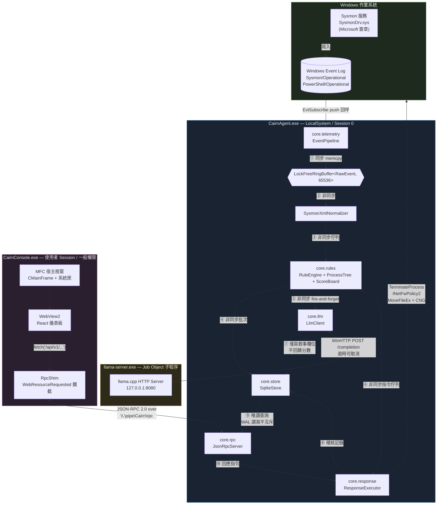
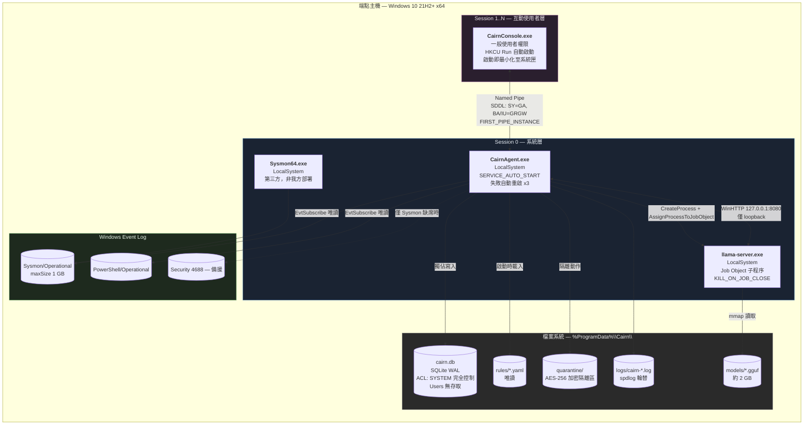
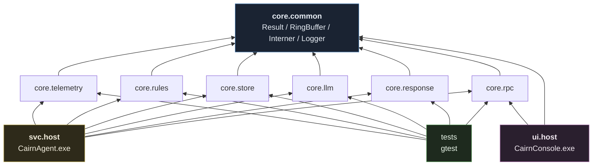
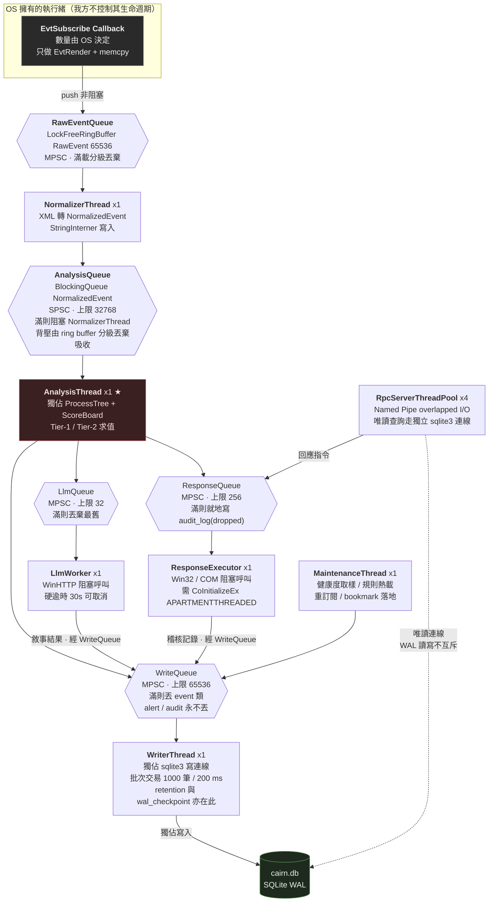
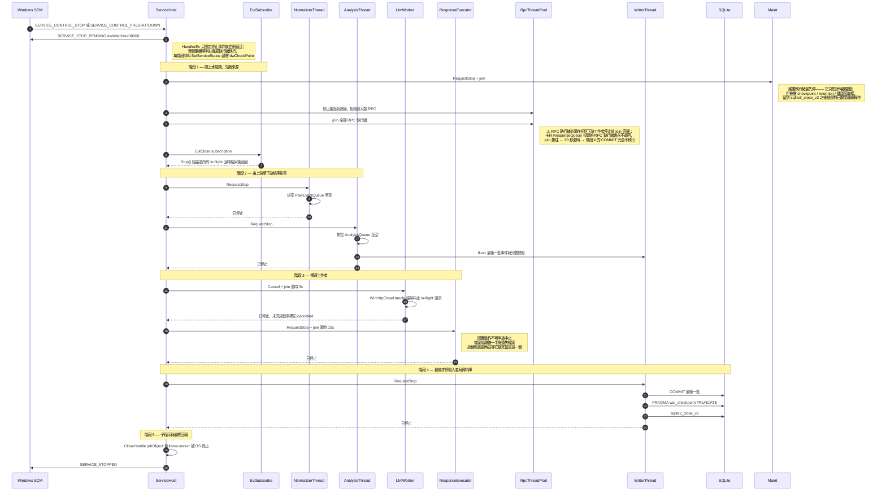
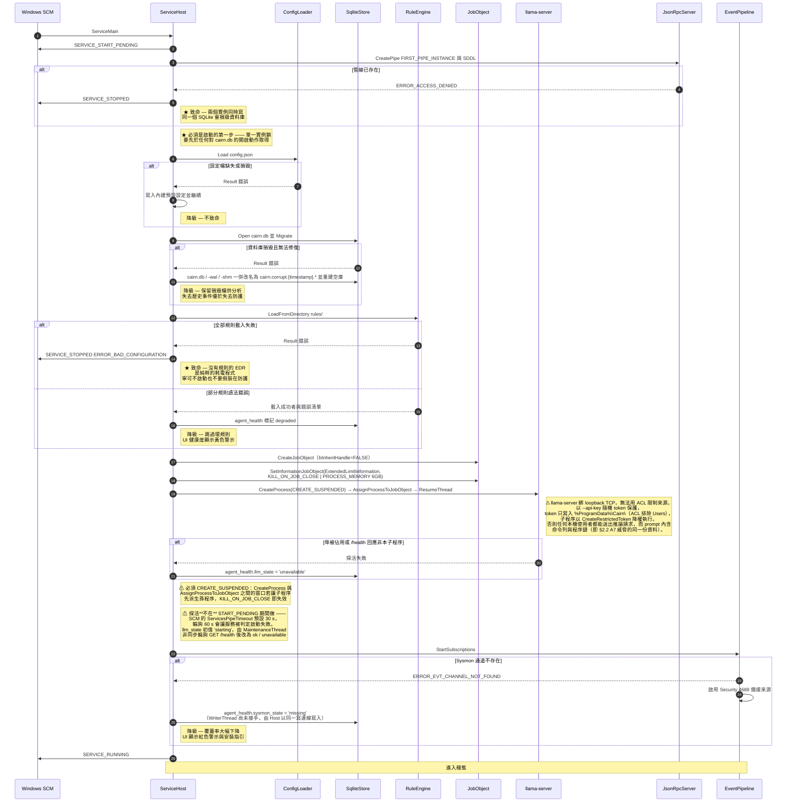
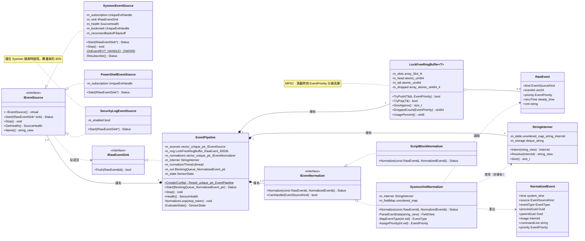
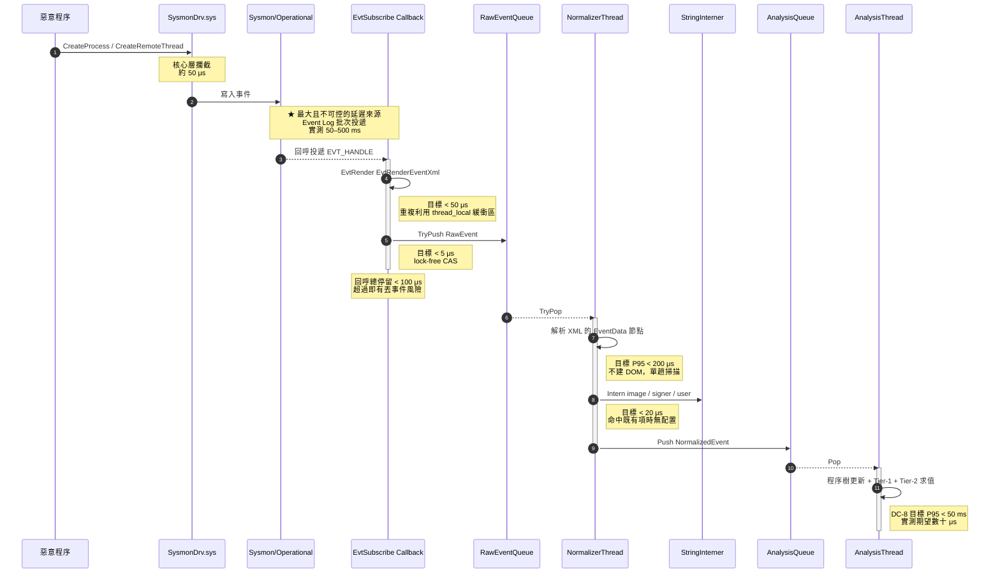
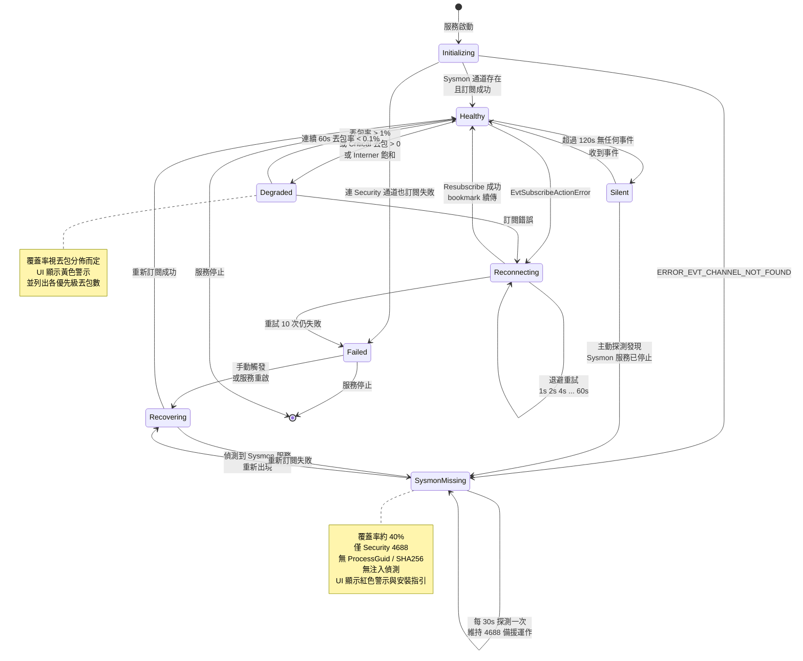

# Cairn M0 — 軟體設計文件 (SDD)
## 第 1 冊：系統架構與感測層詳細設計

| 項目 | 內容 |
|---|---|
| 文件編號 | `SDD-01` |
| 版本 | v0.1 · 2026-08-19 |
| 日期 | 2026-08-19 |
| 狀態 | 待實作審查 (Design Review) |
| 對應 PRD | `docs/part0_overview.md` ~ `docs/part4_plan.md` |
| 技術約定 | `docs/CONVENTIONS.md`（衝突時以該檔為準） |
| 涵蓋範圍 | §1 導論、§2 系統架構、§3 感測層與事件管線 |
| 後續冊次 | `SDD-02` 規則引擎與儲存層、`SDD-03` LLM／回應／UI 與 IPC |

---

# §1 導論

## 1.1 目的與讀者

本文件定義 Cairn M0 的**可實作設計**。它回答的是「這段程式碼要怎麼寫」，而不是「這個產品要解決什麼問題」——後者屬於 PRD。

| 讀者 | 用途 |
|---|---|
| 實作 RD | 依 §2.3 的模組分解認領工作，依 §3 的 header 直接開檔案寫程式 |
| 審查者 | 檢查執行緒模型（§2.5）與錯誤處理（§2.7）是否有競態或資源洩漏 |
| 測試 RD | 依 §2.4 的分層規則判斷哪些邏輯可以純單元測試、哪些需要 fake |
| 後續維護者 | 每個設計決策都附「理由」與「被拒方案」，避免日後重複討論已經否決過的路 |

**本文件不做的事**：不重複 PRD 已經寫過的需求論證、不描述 UI 視覺設計（見 `part3_uiux.md`）、不列出規則內容（見 `part2_arch.md` §2.5）。

## 1.2 範圍

### 1.2.1 本設計涵蓋

- 單機端點代理的完整內部設計：三個程序、其執行緒模型、模組邊界與介面
- 從 Sysmon 事件寫入 Windows Event Log 到規則引擎收到 `NormalizedEvent` 的完整資料路徑
- 服務啟動、穩態運行、優雅關機三個生命週期階段
- 跨模組的錯誤傳遞機制

### 1.2.2 本設計明確不涵蓋（M0 範圍外）

| 不做的項目 | 原因 | 預定版本 |
|---|---|---|
| Kernel driver（Minifilter / ObCallback / WFP callout） | 開發加穩定性測試 ≥ 10 週，且與 M0 要驗證的核心假設無關 | M2 |
| Driver signing / EV 憑證 / WHQL / MVI / ELAM | 純外部等待，前置期以月計 | M1 啟動申請 |
| 自我保護 (Tamper Protection) | 技術上必須有 ELAM 驅動才成立，user-mode 做不到 | M1 |
| 中央管理主控台、多端點、mTLS 註冊 | 單機即可驗證核心假設 | M1 |
| 授權與法務評估（GPL、Sysinternals 散佈條款、模型授權） | M0 為內部自用驗證，不散佈不銷售 | 商品化前 |
| 靜態掃描引擎（YARA / libclamav） | 與差異化主張無關 | 視客戶需求 |

> **必須在設計中誠實承認的後果**：M0 的 `CairnAgent.exe` 可被任何本機管理員以 `sc stop` 或 `taskkill` 終止，且服務被終止後所有偵測即刻停止。設計上唯一的緩解是 §2.6 的 watchdog 與服務失敗自動重啟，這只提高門檻，不構成防護。UI 必須明示此缺口（見 `part3_uiux.md` §3.2.5）。

## 1.3 參考文件

| 編號 | 文件 | 用途 |
|---|---|---|
| R1 | `NextGen_AI_EDR_Specification_v2.docx` | 上游完整商品規格。本設計為其 §2.12.6 方案 A+ 的落地版 |
| R2 | `docs/CONVENTIONS.md` | 語言、工具鏈、程序架構、執行緒模型、命名風格的**唯一權威** |
| R3 | `docs/part0_overview.md` | 三個關鍵技術決策 D-1/D-2/D-3 與其退路 |
| R4 | `docs/part1_product.md` | In/Out of Scope、成功指標、驗收 Demo 腳本 |
| R5 | `docs/part2_arch.md` | Sysmon 組態、SQLite DDL、規則清單、效能預算 M0-P1~P13 |
| R6 | `docs/part3_uiux.md` | UI 資訊架構與 REST 契約（§3.8） |
| R7 | `docs/part4_plan.md` | W1–W4 工作分解與出場條件 |
| R8 | Microsoft, *Windows Event Log API — EvtSubscribe* | §3.2 訂閱機制 |
| R9 | Sysinternals, *Sysmon v15+ Schema* | §3.4 欄位對照 |

## 1.4 術語表

| 術語 | 定義 |
|---|---|
| **ProcessGuid** | Sysmon 為每個程序生成的全域唯一識別碼。**PID 會被作業系統重用，ProcessGuid 不會**，因此所有跨時間的程序關聯一律以 ProcessGuid 為鍵，PID 僅供顯示與呼叫 Win32 API |
| **NormalizedEvent** | 所有事件來源正規化後的統一記錄。規則引擎只認識此型別，不接觸任何來源的原始格式 |
| **RawEvent** | 尚未解析的原始事件，僅含來源標記、`EVT_HANDLE` 渲染後的 XML 字串與接收時戳。存在的唯一理由是讓 OS 回呼執行緒盡快返回 |
| **Tier-0** | 同步阻擋層。**M0 無此層**（需 driver），保留編號以對齊 R1 |
| **Tier-1** | 無狀態單事件規則求值，產生 signal 不直接告警 |
| **Tier-2** | 有狀態時序關聯與累積計分。M0 的偵測主力 |
| **Tier-3** | LLM 敘事層。對已告警事件產出 ATT&CK 映射與攻擊敘事，**不參與加分與阻擋決策** |
| **衰減 (Decay)** | 程序樹風險分數隨時間的指數衰減，避免長時間執行的程序因零星低分事件累積而誤觸 |
| **dryrun** | 規則的一種狀態：正常求值並記錄命中，但不加分、不告警、不執行回應。新規則預設狀態 |
| **canary（誘餌檔案）** | 散佈於使用者目錄的誘餌檔，正常軟體不應觸碰；一被修改即視為勒索行為的高信度訊號。M0 延後至 M1 |
| **EvtSubscribe** | Windows Event Log API 的訂閱函式，push 模式下由 OS 執行緒回呼交付事件 |
| **EVT_HANDLE** | Event Log API 的不透明控制代碼，須以 `EvtClose` 釋放。回呼中交付的 handle **僅在回呼期間有效** |
| **AM-PPL** | Anti-Malware Protected Process Light。使服務無法被管理員終止的保護等級，需 ELAM 驅動。**M0 沒有** |
| **LOLBin** | Living-off-the-Land Binary。系統自帶的合法執行檔（`rundll32`、`mshta`、`regsvr32`…）被攻擊者用於執行惡意 payload |
| **MPSC** | Multi-Producer Single-Consumer。多個生產者執行緒、單一消費者執行緒的佇列模型 |
| **SPSC** | Single-Producer Single-Consumer |
| **分級丟棄 (Graded Drop)** | 佇列接近滿載時，依事件優先級由低至高主動丟棄，確保高價值事件永不遺失 |
| **StringInterner** | 字串駐留表。把高重複字串（映像路徑、簽章者）映射為 32-bit id，降低記憶體與比較成本 |
| **Thread Affinity（執行緒親和性）** | 本文件中特指「某物件只允許被哪一條執行緒觸碰」的約束，而非 CPU 核心綁定 |
| **Result&lt;T&gt;** | 本專案的錯誤傳遞型別，`std::expected` 風格。禁止例外跨模組邊界 |
| **RPC** | 本專案特指 `CairnConsole` 與 `CairnAgent` 之間的 JSON-RPC 2.0 over Named Pipe |
| **Job Object** | Windows 的程序群組管理物件。用於確保 `llama-server.exe` 子程序隨服務終止而終止，不留孤兒 |
| **Graceful Shutdown** | 依既定順序停止各執行緒並排空佇列，確保無資料遺失與無資料庫損毀的關機流程 |
| **ART** | Atomic Red Team。用於驗證偵測覆蓋率的開源攻擊模擬套件 |

## 1.5 設計約束

以下為**不可協商**的約束，皆源自 PRD 或 CONVENTIONS。任何設計方案若違反其中一條即為不合格。

| 編號 | 約束 | 來源 | 對設計的直接影響 |
|---|---|---|---|
| **DC-1** | 不得撰寫或載入任何 kernel driver | R3 D-1 | 一切遙測經 Event Log API 取得；一切回應動作限 user-mode Win32 API |
| **DC-2** | 語言為 C++20，工具鏈 MSVC v143 + CMake + vcpkg | R2 §C-1 | 不得引入需要 GC 執行期的元件；第三方一律經 vcpkg manifest |
| **DC-3** | 僅支援 Windows 10 21H2 x64 以上 | R2 §C-1 | **不做跨平台抽象層**。直接呼叫 Win32 API，不為未來的 Linux 版做無謂的介面抽象 |
| **DC-4** | UI 為 MFC 宿主 + WebView2，且 UI 程序不含任何偵測邏輯 | R2 §C-2 | UI 一切資料經 RPC 取得；UI 崩潰不得影響偵測 |
| **DC-5** | LLM 不參與加分與阻擋決策 | R2 §C-8, R1 §2.8 | 架構上 `LlmWorker` 的輸出**只能寫入 `alerts.ai_narrative` 等欄位，不得回饋至 `ScoreBoard`**。此為型別層級的限制，不是靠自律 |
| **DC-6** | 開發總工期 4 週 | R7 §4.3 | 拒絕任何「為未來擴充預留」的抽象。介面只在單元測試需要注入 fake 時才抽出 |
| **DC-7** | 閒置 CPU ≤ 2%、`CairnAgent` 記憶體 ≤ 300 MB／`CairnConsole` ≤ 350 MB、事件吞吐 ≥ 5,000/s 丟包 < 1% | R5 §2.8 M0-P1/P3/P3b/P5 | 熱路徑禁止逐事件配置記憶體、禁止逐事件開關 SQLite 交易 |
| **DC-8** | 事件處理 Tier-1+Tier-2 P95 ≤ 50 ms | R5 M0-P6 | 分析執行緒上禁止任何同步 I/O、禁止呼叫 LLM、禁止執行回應動作 |
| **DC-9** | 連續運行 7 天無崩潰 | R5 M0-P12 | 無 GC 兜底，所有資源一律 RAII；任何裸 `new` / Win32 handle 未包 RAII 者視為缺陷 |
| **DC-10** | 回應動作僅四種 user-mode（C-9），其中三種可還原；`terminate_process_tree` 不可逆 | R2 §C-8 | `ResponseExecutor` 必須記錄足以還原的中繼資料，且還原路徑須有測試 |

---

# §2 系統架構

## 2.1 架構總覽



**圖說**：本圖是全系統的元件視圖，三個彩色分區即 CONVENTIONS §C-2 的三個程序。三條關鍵資訊要從圖上讀出來：

1. **只有 ① 是同步的**。`EvtSubscribe` 的回呼跑在 OS 擁有的執行緒上，我們在其中只做一次 `memcpy` 進 ring buffer 就返回。②~⑩ 全是非同步。這是 DC-7（吞吐 ≥ 5,000/s、丟包 < 1%）能否達成的前提——若在回呼中解析 XML 或寫資料庫，Event Log 訂閱會因回呼過慢而開始丟事件，且丟的是哪些我們無法控制。
2. **⑦ 是單向虛線**。`LlmClient` 的輸出只能流向 `SqliteStore` 的敘事欄位，**沒有任何一條線從 `LlmClient` 指回 `RuleEngine`**。這是 DC-5 在架構圖上的體現：LLM 對分數與阻擋決策的影響路徑在結構上就不存在，不需要靠程式碼審查來保證。
3. **UI 不碰 OS，也不碰 SQLite**。`CairnConsole.exe` 唯一的對外連線是 Named Pipe。它沒有偵測邏輯、沒有資料庫控制代碼、沒有提權需求。UI 崩潰或被使用者關閉，偵測完全不受影響（DC-4）。

## 2.2 程序與部署視圖



**圖說**：本圖強調的是**權限邊界**與**檔案系統的存取控制**，這是無自我保護能力下唯一還能做的縱深防禦。

- **跨 Session 邊界只有一條通道**：`CairnConsole.exe` 跑在互動使用者的 Session，與 Session 0 的服務之間只透過 Named Pipe 溝通。Named Pipe 的 SDDL 允許互動使用者讀寫（否則一般使用者開不了 UI），但**所有具破壞性的指令另需 §SDD-03 定義的一次性 `confirmation_token`**，該 token 由服務端生成並綁定告警 id 與動作類型，UI 無法自行偽造。
- **`cairn.db` 的 ACL 排除 Users**：一般使用者無法讀取事件資料庫。這對應 R1 §2.2 的 A7 威脅（竊取事件庫做內部偵察，庫中含命令列參數，常含明文密碼與 token）。管理員仍可讀——M0 無法防禦管理員，見 §1.2.2 的誠實揭露。
- **`llama-server.exe` 用 Job Object 管理**：設定 `JOB_OBJECT_LIMIT_KILL_ON_JOB_CLOSE`，服務程序無論是正常結束或崩潰，子程序都會被 OS 一併終止。**被拒方案**：以 `TerminateProcess` 在服務關機時主動殺子程序——服務崩潰時這段程式碼根本不會執行，會留下佔用 2 GB 記憶體的孤兒程序。
- **`Sysmon64.exe` 標為「非我方部署」**：M0 要求使用者自行安裝 Sysmon 並套用我方 `config/sysmon.xml`。這是 §1.2.2 授權議題延後的直接後果——我們不打包散佈它。

## 2.3 模組分解

所有偵測邏輯位於 `core.*` 靜態庫，`svc.host` 與 `ui.host` 只是這些庫的宿主。

| 模組 | 產物 | 職責 | 對外介面 | 相依於 |
|---|---|---|---|---|
| `core.common` | 靜態庫 `cairn_common.lib` | `Result<T>`、錯誤碼、`StringInterner`、`LockFreeRingBuffer<T,N>`、時間工具、`ILogger` | `Result.h` `Errors.h` `RingBuffer.h` `Interner.h` `model/NormalizedEvent.h` `model/EventType.h` `ResponseCommand.h` | 無（僅標準庫 + wil） |
| `core.telemetry` | 靜態庫 `cairn_telemetry.lib` | 事件訂閱、原始事件緩衝、XML 正規化、感測層健康狀態機 | `IEventSource` `IEventNormalizer` `EventPipeline` | `core.common` |
| `core.rules` | 靜態庫 `cairn_rules.lib` | YAML 規則載入與 AST 編譯、Tier-1/Tier-2 求值、`ProcessTree`、`ScoreBoard`、告警生成 | `RuleEngine` `IRuleSink` `ProcessTree` | `core.common` |
| `core.store` | 靜態庫 `cairn_store.lib` | SQLite 開啟與 schema migration、批次寫入、查詢 DAO、retention 清理 | `IEventStore` `IAlertStore` `IAuditStore` | `core.common` |
| `core.llm` | 靜態庫 `cairn_llm.lib` | Prompt 組裝與輸入隔離、WinHTTP 呼叫、JSON schema 驗證、逾時與降級 | `ILlmClient` `NarrativeRequest` | `core.common` |
| `core.response` | 靜態庫 `cairn_response.lib` | 程序暫停／終止程序樹、防火牆封鎖、檔案隔離與還原、稽核寫入 | `IResponseExecutor` `ResponseCommand` | `core.common` |
| `core.rpc` | 靜態庫 `cairn_rpc.lib` | Named Pipe 伺服器、JSON-RPC 2.0 分派、方法註冊表、確認 token 管理 | `JsonRpcServer` `IRpcMethod` | `core.common` |
| `svc.host` | 執行檔 `CairnAgent.exe` | SCM 整合、設定載入、所有執行緒的建立與關機協調、子程序生命週期 | — | 全部 `core.*` |
| `ui.host` | 執行檔 `CairnConsole.exe` | MFC 宿主視窗、WebView2 初始化、資源供應、`RpcShim`、系統匣與 Toast | — | `core.common` `core.rpc`（僅 client 端） |
| `ui.web` | 靜態資源 | React 儀表板，建置產物嵌入 `CairnConsole.exe` 資源區 | — | 無（透過 `fetch` 契約） |

> **與 CONVENTIONS C-2.2 的 8 個靜態庫對照**：本表定義 7 個 `cairn_*.lib`。
> C-2.2 另列的 **`cairn_core`** 是一個 CMake `INTERFACE` 匯總目標
> （＝ `cairn_common` + `cairn_rules` + `cairn_store`），供 `tests` 與 `svc.host` 一次連結，
> 不產生獨立的 `.lib`。part4 §4.2 的 `target_link_libraries(cairn_tests PRIVATE cairn_core ...)` 即指此目標。

**模組切分原則**：一個模組成為獨立靜態庫的條件是「它有可以單獨測試的邏輯」。因此 `core.common` 到 `core.rpc` 都是庫，而 `svc.host` 只有黏合程式碼與 Win32 服務樣板，不值得為它寫單元測試。

## 2.4 套件相依圖與分層規則



**圖說與分層規則**：箭頭方向即編譯期相依方向，全部指向下方的 `core.common`。三條強制規則：

| 規則 | 內容 | 違反的後果 |
|---|---|---|
| **L-1** | `core.*` 模組**不得**相依 `svc.host` 或 `ui.host` | 一旦 core 需要宿主才能編譯，單元測試就必須拉起整個服務。這是「測不動」的起點 |
| **L-2** | `core.*` 模組彼此**不得**橫向相依（唯一例外是全部可依賴 `core.common`）。**跨模組傳遞的資料型別一律定義於 `core.common`**：`NormalizedEvent`、`EventType`、`Guid`、`ResponseCommand`、`Result<T>` | 例如 `core.rules` 若直接 include `core.store`，規則引擎的測試就得準備一個 SQLite 檔。實際作法是 `core.rules` 定義 `IRuleSink` 介面，由 `svc.host` 注入 `core.store` 的實作。同理 `ResponseCommand` 若留在 `core.response`，`core.rpc` 就得橫向相依它 |
| **L-3** | `core.*` 模組**與 `svc.host`** 皆不得 include `<afx*.h>`（MFC）或任何 UI 標頭；MFC 僅允許出現在 `ui.host` | MFC 標頭會拖入大量宏定義並要求特定的執行期設定，污染後所有 core 都無法在 gtest 的 console 專案中連結 |

**這條分層規則換來的具體好處**：`core.rules` 的整套規則求值、程序樹重建、分數衰減邏輯都可以在**不需要 Windows 事件、不需要 Sysmon、不需要資料庫**的情況下用 gtest 直接餵假事件測試。這是 R7 §4.5 測試策略成立的結構前提，也是 4 週工期下敢於重構的唯一保障。

**被拒方案**：把所有東西放進單一 `CairnAgent` 專案，靠資料夾分目錄。理由——編譯器不會強制執行資料夾邊界，三週後必然出現 `RuleEngine.cpp` 直接呼叫 `sqlite3_step` 的情況，屆時測試已無法補救。用獨立靜態庫是讓連結器替我們把關。

---

## 2.5 執行緒模型

> 本節是整份 SDD 最關鍵的一節。M0 若失敗，最可能的死因不是偵測率不足，而是**執行緒設計錯誤導致的競態、死鎖或資料庫損毀**。任何實作與本節不符者，一律視為缺陷而非「另一種寫法」。

### 2.5.1 執行緒與佇列全圖



**圖說**：紅色的 `AnalysisThread` 是整個系統的**序列化點**，所有具狀態的判斷都在它身上發生。它的上游有一個緩衝佇列吸收突發流量，下游三條路全部是**非阻塞投遞**——`AnalysisThread` 投完就走，絕不等待結果。這是 DC-8（P95 ≤ 50 ms）的結構保證：分析執行緒上不存在任何可能阻塞數百毫秒的操作。

`T4`（LLM）與 `T5`（回應執行）之所以各自獨立且允許阻塞，是因為它們的工作本質上就是慢的：LLM 推論以秒計，`INetFwPolicy2` 的 COM 呼叫與 AES 檔案加密以數百毫秒計。把它們留在管線上會直接讓事件匯流排爆掉。

### 2.5.2 執行緒規格表

| 執行緒 | 數量 | 職責 | 允許阻塞 | 獨佔擁有的狀態 | 輸入 | 輸出 |
|---|---|---|---|---|---|---|
| `EvtSubscribe Callback` | OS 決定 | `EvtRender` 取 XML、建 `RawEvent`、push | **絕對禁止** | 無 | OS 回呼 | `RawEventQueue` |
| `NormalizerThread` | 1 | XML 解析、欄位映射、字串駐留 | **是**（僅在 `AnalysisQueue` 滿時；背壓最終由 ring buffer 的分級丟棄吸收，不會回壓到 OS 回呼） | `StringInterner`（唯一寫者） | `RawEventQueue` | `AnalysisQueue` |
| **`AnalysisThread`** | **1** | 程序樹維護、Tier-1/Tier-2 求值、分數累加與衰減、告警生成 | **絕對禁止** | **`ProcessTree`、`ScoreBoard`、`RuleEngine` 求值狀態** | `AnalysisQueue` | `WriteQueue` / `LlmQueue` / `ResponseQueue` |
| `WriterThread` | 1 | 批次交易寫入 SQLite | 是 | 寫入用 `sqlite3*` 連線（唯一持有者） | `WriteQueue` | `cairn.db` |
| `LlmWorker` | 1 | Prompt 組裝、WinHTTP 呼叫、schema 驗證 | 是 | WinHTTP session handle | `LlmQueue` | `WriteQueue`（僅敘事欄位） |
| `ResponseExecutor` | 1 | 暫停、終止程序樹、防火牆規則、檔案隔離 | 是 | COM apartment、隔離區目錄鎖 | `ResponseQueue` | `WriteQueue`（稽核） |
| `RpcServerThreadPool` | 4 | Named Pipe 接受連線、JSON-RPC 分派、唯讀查詢 | 是 | 每執行緒一個唯讀 `sqlite3*` 連線 | Named Pipe | Named Pipe / `ResponseQueue` |
| `MaintenanceThread` | 1 | 健康度取樣、規則檔變更偵測與熱載、感測層重訂閱、bookmark 落地 | 是 | 無 | 計時器 | `WriteQueue`（**唯一出口**） |

合計常駐執行緒：**1 + 1 + 1 + 1 + 1 + 4 + 1 = 10 條**（不含 OS 回呼執行緒）。

### 2.5.3 鐵則：`AnalysisThread` 單執行緒獨佔 `ProcessTree` 與 `ScoreBoard`

**規則陳述**：`ProcessTree`、`ScoreBoard`、以及 `RuleEngine` 內所有 `sequence` 規則的中間比對狀態，**只能由 `AnalysisThread` 讀寫**。這些類別**不提供任何鎖，也不做執行緒安全設計**。任何其他執行緒若需要這些資料，必須透過訊息傳遞取得一份**快照複本**。

**為何不用讀寫鎖（`std::shared_mutex`）**：

| 理由 | 說明 |
|---|---|
| 鎖的粒度無解 | 程序樹是高度互連的圖。一條 `sequence` 規則的求值可能同時觸碰數十個節點與多條規則的中間狀態。要嘛用一把大鎖（等同序列化，卻多付鎖的代價），要嘛用細粒度鎖（必然出現鎖順序不一致而死鎖） |
| 讀者不是真的只讀 | 分數衰減、`sequence` 狀態推進、節點 last-seen 更新，這些看似「讀」的操作其實都會寫。讀寫鎖在此毫無優勢 |
| 效能上沒必要 | 依 DC-7，M0 目標 5,000 事件/秒，單執行緒處理一個事件的預算是 200 μs，而 Tier-1/Tier-2 求值在數十 μs 量級。**單執行緒綽綽有餘，沒有理由付出並行的複雜度** |
| 可測試性 | 單執行緒求值是確定性的：同樣的事件序列必然產生同樣的分數，單元測試可以直接斷言分數數值。加入並行後這個性質即刻消失 |

**違反此鐵則會出現什麼 bug**：這是實作者最容易犯的錯，因此具體寫出來——

1. **RPC 執行緒直接讀 `ProcessTree` 以回應 `GET /api/v1/alerts/{id}` 的程序樹**：`AnalysisThread` 正因 EID 5（程序結束）移除節點，RPC 執行緒同時走訪子節點串列，迭代器失效，存取已釋放記憶體，服務崩潰。**因為沒有 GC，這會直接是 access violation**，且崩潰點在 RPC 執行緒，離真正成因很遠，極難除錯。
2. **`LlmWorker` 讀分數以決定 prompt 內容**：除競態外，這還會實質違反 DC-5——一旦 LLM 能讀取即時分數，就有人會在下一次迭代中「順手」讓它寫回去。
3. **`ResponseExecutor` 讀程序樹以取得要終止的子程序清單**：終止程序樹是持續數百毫秒的操作，期間樹的結構會變。**正確作法**：`AnalysisThread` 投遞 `ResponseCommand` 時就把當下的 PID 與 ProcessGuid 清單**複製進指令本身**，`ResponseExecutor` 只操作這份快照。

**正確的快照機制**：`AnalysisThread` 每處理完一批事件後，把需要對外暴露的狀態（程序樹結構、當前分數）序列化後投入 `WriteQueue` 寫入 SQLite。**RPC 一律從 SQLite 讀，不從記憶體讀**。代價是資料有最多 200 ms 延遲，對 UI 完全可接受。

### 2.5.4 優雅關機時序



**圖說與關機設計原則**：

| 原則 | 說明 |
|---|---|
| **由上游往下游停** | 順序是 事件來源 → Normalizer → Analysis → 慢速工作者 → Writer → DB。反過來做（先停 Writer）會讓上游佇列爆滿並開始丟棄，等於在關機時刻意丟資料 |
| **先斷來源再排空** | 階段 1 必須先 `EvtClose`，否則 Normalizer 永遠排不空——事件還在持續流入 |
| **`LlmWorker` 可以粗暴中止** | 敘事沒生成完全無損失，重開機後可由 UI 觸發重新生成。**用 `WinHttpCloseHandle` 讓阻塞中的 `WinHttpReceiveResponse` 立刻返回錯誤**，這比設旗標然後等 30 秒硬逾時（20 s 是 M0-P8 的 P95 目標，不是逾時值）實際得多 |
| **`ResponseExecutor` 不可粗暴中止** | 檔案隔離的中途狀態是「原檔已移走但加密未完成」，這會實際弄丟使用者的檔案。給 10 秒逾時等它做完當前這一個；若真逾時，寫入一筆 `audit` 記錄標記 `interrupted` 供事後人工處理 |
| **`wal_checkpoint(TRUNCATE)` 是必要的** | 不做 checkpoint 就關閉，WAL 檔會殘留且下次開啟需恢復，在 4 GB 資料庫上會讓服務啟動慢上數秒。TRUNCATE 模式把 WAL 併回主檔並清空 |
| **`dwWaitHint` 要誠實** | 設 30 秒，並在每階段完成時呼叫 `SetServiceStatus` 更新 checkpoint。若不更新，SCM 會在預設逾時後直接殺掉程序，階段 4 就不會執行，資料庫將處於未 checkpoint 狀態 |
| **必須註冊 `SERVICE_ACCEPT_PRESHUTDOWN`** | 系統關機走的是 `SERVICE_CONTROL_SHUTDOWN`，其預設 `WaitToKillServiceTimeout` 只有 **5 秒**——本流程（LLM 3s + Response 10s + 排空 + checkpoint）必然被強制終止，資料庫留在未 checkpoint 狀態。服務以 `SERVICE_ACCEPT_STOP \| SERVICE_ACCEPT_PRESHUTDOWN` 註冊，`SERVICE_CONTROL_PRESHUTDOWN` 走同一套流程，可取得約 180 秒 |
| **RPC 先於下游工作者停止** | 見階段 1 的註記。`ResponseExecutor` 停止後，任何仍卡在投遞或等待結果的 RPC 執行緒都不會返回 |

## 2.6 啟動時序



**圖說與啟動設計原則**：整個啟動流程的主軸是**盡可能降級，只有兩件事致命**。

| 分類 | 項目 | 理由 |
|---|---|---|
| **致命** | 規則全部載入失敗 | 沒有規則的 EDR 不會產生任何告警，卻佔用資源並讓使用者誤以為受保護。這比明確失敗更危險 |
| **致命** | Named Pipe 已被佔用 | 代表已有另一個服務實例在跑。兩個實例同時寫同一個 SQLite 檔會造成資料庫損毀。`FILE_FLAG_FIRST_PIPE_INSTANCE` 在此同時扮演「單一實例鎖」 |
| 降級 | 設定檔缺失 | 用內建預設值 |
| 降級 | 資料庫損毀 | 改名保留後重建空庫。歷史事件可以失去，防護不能中斷 |
| 降級 | 部分規則語法錯誤 | 載入好的規則，壞的列入健康度警示 |
| 降級 | `llama-server` 起不來 | Tier-3 是**加值**不是**核心**。DC-5 已保證 LLM 不參與決策，故它不可用時偵測能力完全不變 |
| 降級 | Sysmon 缺席 | 切到 Security 4688 備援，覆蓋率降至約 40%，UI 明確警示（見 §3.6 狀態機） |

**啟動順序的相依性**：規則必須在事件訂閱**之前**載入完成——否則訂閱一開，事件湧入時規則引擎還沒準備好，這些事件只能丟棄。同理 `JsonRpcServer` 必須在 `SERVICE_RUNNING` 之前建立，否則 UI 可能在服務宣告 running 後立刻連線卻收到 pipe not found。

## 2.7 錯誤處理與 Result&lt;T&gt; 設計

### 2.7.1 設計原則

| 原則 | 內容 |
|---|---|
| **P-1** | **例外不得跨模組邊界**。`core.*` 的所有公開函式一律以 `Result<T>` 回傳，不得 `throw` |
| **P-2** | 模組**內部**允許使用例外（`yaml-cpp`、`nlohmann::json` 會拋），但必須在公開介面的實作處 `catch` 並轉為 `Result<T>` |
| **P-3** | 建構子不得失敗。可能失敗的初始化一律用**靜態工廠函式**回傳 `Result<T>`，建構子設為 private |
| **P-4** | `Result<T>` 標記 `[[nodiscard]]`，忽略回傳值即編譯警告，配合 `/WX` 成為編譯錯誤 |
| **P-5** | Win32 錯誤一律保留原始 `DWORD`，不要轉成自訂碼後丟失資訊。除錯時 `GetLastError()` 的原值是最有用的線索 |

**為何不用例外**：這不是教條，而是三個具體理由——（a）跨越 `core.*` 靜態庫邊界時，例外要求所有模組的 CRT 與編譯選項完全一致，而我們同時要連結 MFC（`ui.host`）與 console 測試程式（`tests`），設定分歧風險高；（b）事件處理熱路徑上例外成本不可預測，違反 DC-8 的 P95 承諾；（c）Win32 API 本來就以回傳碼溝通錯誤，用 `Result<T>` 讓兩者風格一致，不需在每個 API 呼叫處寫 try/catch 轉換層。

**被拒方案**：用 `std::optional<T>` 加 `GetLastError()`。理由——`optional` 丟失錯誤原因，而 `GetLastError()` 是 thread-local 且極易被中間的其他 API 呼叫覆蓋，在非同步管線中根本不可靠。

### 2.7.2 錯誤碼分層

```cpp
// core/common/Errors.h
#pragma once
#include <cstdint>
#include <string>
#include <string_view>

namespace cairn {

// 錯誤類別 —— 每個子系統一段，避免不同模組的錯誤碼撞號。
// 高位元組即子系統編號，除錯時看數值就知道是誰報的錯。
enum class ErrorDomain : uint8_t {
    General   = 0x00,
    Telemetry = 0x01,
    Rules     = 0x02,
    Store     = 0x03,
    Llm       = 0x04,
    Response  = 0x05,
    Rpc       = 0x06,
    Win32     = 0xFF,   // 直接轉載 Win32 / HRESULT
};

enum class ErrorCode : uint32_t {
    Ok                      = 0x00000000,

    // General
    InvalidArgument         = 0x00000001,
    NotInitialized          = 0x00000002,
    Cancelled               = 0x00000003,
    Timeout                 = 0x00000004,
    NotFound                = 0x00000005,
    AlreadyExists           = 0x00000006,
    OutOfMemory             = 0x00000007,

    // Telemetry
    ChannelNotFound         = 0x01000001,
    SubscribeFailed         = 0x01000002,
    RenderFailed            = 0x01000003,
    MalformedEventXml       = 0x01000004,
    QueueFull               = 0x01000005,
    SysmonNotInstalled      = 0x01000006,

    // Rules
    RuleParseError          = 0x02000001,
    RuleSchemaViolation     = 0x02000002,
    UnknownRuleField        = 0x02000003,
    NoRulesLoaded           = 0x02000004,   // 致命，見 2.6

    // Store
    DbOpenFailed            = 0x03000001,
    DbCorrupt               = 0x03000002,
    MigrationFailed         = 0x03000003,
    DbBusy                  = 0x03000004,
    DbDiskFull              = 0x03000005,

    // Llm
    LlmUnavailable          = 0x04000001,
    LlmTimeout              = 0x04000002,
    LlmSchemaViolation      = 0x04000003,
    LlmContextOverflow      = 0x04000004,

    // Response
    ProcessGone             = 0x05000001,   // 目標程序已結束 —— 非錯誤，屬正常競態
    AccessDenied            = 0x05000002,
    FirewallComFailed       = 0x05000003,
    QuarantineIoFailed      = 0x05000004,
    RestoreHashMismatch     = 0x05000005,

    // Rpc
    PipeBusy                = 0x06000001,
    BadRpcRequest           = 0x06000002,
    ConfirmationRequired    = 0x06000003,
    ConfirmationExpired     = 0x06000004,
};

[[nodiscard]] constexpr ErrorDomain DomainOf(ErrorCode c) noexcept {
    return static_cast<ErrorDomain>((static_cast<uint32_t>(c) >> 24) & 0xFF);
}

// 錯誤實體：碼 + 上下文字串 + 可選的原始 Win32 碼。
// 上下文字串只給人看（日誌與 UI），程式判斷一律看 code。
struct Error {
    ErrorCode   code  = ErrorCode::Ok;
    uint32_t    win32 = 0;               // GetLastError / HRESULT 原值，0 表無
    std::string context;                 // 例如 "EvtSubscribe(Sysmon/Operational)"

    [[nodiscard]] bool IsOk() const noexcept { return code == ErrorCode::Ok; }
    [[nodiscard]] std::string ToString() const;
};

[[nodiscard]] Error MakeError(ErrorCode c, std::string_view ctx);
[[nodiscard]] Error MakeWin32Error(ErrorCode c, uint32_t lastError, std::string_view ctx);

} // namespace cairn
```

### 2.7.3 Result&lt;T&gt; 實作

```cpp
// core/common/Result.h
#pragma once
#include <type_traits>
#include <utility>
#include "Errors.h"
#include "Assert.h"          // CAIRN_ASSERT

namespace cairn {

// 語意與 std::expected 一致。自行實作以避免相依編譯器的 _HAS_CXX23 開關。
template <class T>
class [[nodiscard]] Result {
public:
    Result(T value) noexcept(std::is_nothrow_move_constructible_v<T>)
        : m_value(std::move(value)), m_hasValue(true) {}

    Result(Error err) noexcept
        : m_error(std::move(err)), m_hasValue(false) {}

    [[nodiscard]] bool HasValue() const noexcept { return m_hasValue; }
    explicit operator bool() const noexcept { return m_hasValue; }

    // 前置條件：HasValue() == true。違反即為程式錯誤，以 assert 攔截。
    [[nodiscard]] T&       Value() &      { CAIRN_ASSERT(m_hasValue); return m_value; }
    [[nodiscard]] const T& Value() const& { CAIRN_ASSERT(m_hasValue); return m_value; }
    [[nodiscard]] T&&      Value() &&     { CAIRN_ASSERT(m_hasValue); return std::move(m_value); }

    [[nodiscard]] const Error& GetError() const noexcept { CAIRN_ASSERT(!m_hasValue); return m_error; }
    [[nodiscard]] ErrorCode    Code()     const noexcept { return m_hasValue ? ErrorCode::Ok : m_error.code; }

    // 用於「失敗不影響流程」的場合
    [[nodiscard]] T ValueOr(T fallback) const& { return m_hasValue ? m_value : std::move(fallback); }

private:
    T     m_value{};
    Error m_error{};
    bool  m_hasValue = false;
};

// void 特化：只表達成敗
template <>
class [[nodiscard]] Result<void> {
public:
    Result() noexcept : m_hasValue(true) {}
    Result(Error err) noexcept : m_error(std::move(err)), m_hasValue(false) {}

    [[nodiscard]] bool HasValue() const noexcept { return m_hasValue; }
    explicit operator bool() const noexcept { return m_hasValue; }
    [[nodiscard]] const Error& GetError() const noexcept { CAIRN_ASSERT(!m_hasValue); return m_error; }
    [[nodiscard]] ErrorCode    Code()     const noexcept { return m_hasValue ? ErrorCode::Ok : m_error.code; }

private:
    Error m_error{};
    bool  m_hasValue = false;
};

using Status = Result<void>;

// 早退巨集 —— 讓錯誤傳遞不至於淹沒業務邏輯。
// 用法： CAIRN_TRY(auto db, SqliteStore::Open(path, ConnRole::ReadWrite));
#define CAIRN_CONCAT_(a, b) a##b
#define CAIRN_CONCAT(a, b)  CAIRN_CONCAT_(a, b)

#define CAIRN_TRY(decl, expr)                                   \
    auto CAIRN_CONCAT(_r_, __LINE__) = (expr);                  \
    if (!CAIRN_CONCAT(_r_, __LINE__))                           \
        return CAIRN_CONCAT(_r_, __LINE__).GetError();          \
    decl = std::move(CAIRN_CONCAT(_r_, __LINE__)).Value()

#define CAIRN_CHECK(expr)                                       \
    do {                                                        \
        auto CAIRN_CONCAT(_s_, __LINE__) = (expr);              \
        if (!CAIRN_CONCAT(_s_, __LINE__))                       \
            return CAIRN_CONCAT(_s_, __LINE__).GetError();      \
    } while (0)

} // namespace cairn
```

### 2.7.4 P-3「建構子不得失敗」的落實範例

```cpp
// core/store/SqliteStore.h  （節錄，完整設計見 SDD-02）
namespace cairn::store {

enum class ConnRole { ReadWrite, ReadOnly };

class SqliteStore {
public:
    // 工廠函式：唯一的建立途徑。開檔、migration、PRAGMA 設定皆可能失敗。
    [[nodiscard]] static Result<std::unique_ptr<SqliteStore>>
        Open(const std::filesystem::path& dbPath, ConnRole mode);

    ~SqliteStore();                                 // RAII: sqlite3_close_v2
    SqliteStore(const SqliteStore&)            = delete;
    SqliteStore& operator=(const SqliteStore&) = delete;
    SqliteStore(SqliteStore&&) noexcept;
    SqliteStore& operator=(SqliteStore&&) noexcept;

private:
    explicit SqliteStore(sqlite3* db) noexcept;     // private：不可能被外部誤用
    sqlite3* m_db = nullptr;
};

} // namespace cairn::store
```

**這個模式的價值**：呼叫端拿到 `std::unique_ptr<SqliteStore>` 時，它**必然是可用的**。不需要在每個成員函式開頭檢查 `if (!m_initialized)`，也不會出現「物件存在但處於半初始化狀態」這種只能靠註解約束的隱形狀態。

---

# §3 感測層與事件管線詳細設計

本章對應模組 `core.telemetry`，職責邊界是：**從 Windows Event Log 取得原始事件，交付一串 `NormalizedEvent` 給 `AnalysisThread`**。它不認識規則、不認識分數、不寫資料庫。

## 3.1 類別圖



**圖說**：三個要點。

1. **`EventPipeline` 是唯一的擁有者**（實心菱形），所有 source、normalizer、ring buffer、interner 的生命週期都繫於它。`svc.host` 只持有一個 `unique_ptr<EventPipeline>`，關機時解構它就會依序停掉所有訂閱。這避免了「訂閱還活著但 sink 已經被釋放」這種在回呼模型中最常見的懸空指標。
2. **`IEventSource` 只依賴 `IRawEventSink` 介面**，不知道下游是 ring buffer 還是別的東西。單元測試中可以注入一個把事件收進 `vector` 的 fake sink，直接驗證 `SysmonEventSource` 的 XML 是否正確交付，不需要真的跑 ring buffer。
3. **`StringInterner` 被 `SysmonXmlNormalizer` 使用但不被它擁有**（虛線依賴）。原因是 interner 的生命週期必須長於所有 normalizer，且 `NormalizedEvent` 中的 `InternId` 在下游 `AnalysisThread` 解析時仍需查詢它。擁有權放在 `EventPipeline`。

## 3.2 `IEventSource` 與各實作

### 3.2.1 介面定義

```cpp
// core/telemetry/IEventSource.h
#pragma once
#include <string_view>
#include "common/Result.h"
#include "RawEvent.h"

namespace cairn::telemetry {

enum class SourceHealth {
    Stopped,        // 尚未啟動或已停止
    Healthy,        // 訂閱中且近期有事件
    Silent,         // 訂閱中但超過 SilentThreshold 沒有任何事件（可疑）
    Reconnecting,   // 訂閱掉了，正在退避重試
    Failed,         // 重試次數耗盡，放棄
};

// 原始事件的接收端。實作者必須是執行緒安全的（多個 source 會併發呼叫）。
class IRawEventSink {
public:
    virtual ~IRawEventSink() = default;

    // 回傳 false 表示佇列已滿且此事件被丟棄。呼叫端不得因此重試或阻塞。
    // 執行緒親和性：由 OS 回呼執行緒呼叫，實作必須是 lock-free。
    // ⚠ `ev.priority` 必須由**來源端**在此之前填好：分級丟棄發生在入佇列的當下，
    //   若等到 Normalizer 才決定優先級，ring buffer 已經丟過一輪，分級形同虛設。
    //   各 IEventSource 以 `static constexpr EventPriority PriorityOfEid(uint16_t)`
    //   （定義於 core.common）查表指定，成本為一次陣列索引。
    [[nodiscard]] virtual bool Push(RawEvent&& ev) noexcept = 0;
};

// 事件來源。生命週期由 EventPipeline 擁有。
// 執行緒親和性：Start/Stop 僅可由控制執行緒呼叫；回呼發生在 OS 執行緒。
class IEventSource {
public:
    virtual ~IEventSource() = default;

    // sink 必須在本物件解構前保持有效。
    [[nodiscard]] virtual Status Start(IRawEventSink* sink) = 0;

    // 冪等。**阻塞至所有 in-flight 回呼結束後才返回**（見 3.2.3 的關閉競態處理）。
    // ⚠ wevtapi 並不保證 EvtClose 之後回呼不再被呼叫，單靠 m_stopping 旗標
    //   與其後的 sink->Push 之間有時間窗，EventPipeline 解構後即為 use-after-free。
    //   實作：m_stopping.store(release) → EvtClose(訂閱) → 以 SRWLOCK（回呼取 shared、
    //   Stop 取 exclusive）等待 in-flight 計數歸零。
    virtual void Stop() noexcept = 0;

    [[nodiscard]] virtual SourceHealth GetHealth() const noexcept = 0;
    [[nodiscard]] virtual std::string_view Name() const noexcept = 0;
};

} // namespace cairn::telemetry
```

### 3.2.2 `SysmonEventSource` 完整 header

```cpp
// core/telemetry/SysmonEventSource.h
#pragma once
#include <windows.h>
#include <winevt.h>
#include <atomic>
#include <chrono>
#include <wil/resource.h>
#include "IEventSource.h"

#pragma comment(lib, "wevtapi.lib")

namespace cairn::telemetry {

// wil 沒有內建 EVT_HANDLE 的 RAII，自行定義。
struct EvtHandleDeleter {
    void operator()(EVT_HANDLE h) const noexcept { if (h) ::EvtClose(h); }
};
using UniqueEvtHandle = std::unique_ptr<std::remove_pointer_t<EVT_HANDLE>, EvtHandleDeleter>;

class SysmonEventSource final : public IEventSource {
public:
    struct Config {
        std::wstring channel   = L"Microsoft-Windows-Sysmon/Operational";
        // 只訂閱我們真正會用到的 EID，讓 OS 層先過濾，比在我方程式碼中丟棄便宜得多。
        std::wstring xpathQuery =
            L"*[System[EventID=1 or EventID=3 or EventID=5 or EventID=7 or "
            L"EventID=8 or EventID=10 or EventID=11 or EventID=12 or EventID=13 or "
            L"EventID=14 or EventID=15 or EventID=17 or EventID=18 or EventID=22 or "
            L"EventID=23 or EventID=25 or EventID=26]]";
        std::chrono::seconds silentThreshold{120};   // 對齊 part2 §2.2.3 的 silence_timeout
        uint32_t maxReconnectAttempts = 10;
    };

    [[nodiscard]] static Result<std::unique_ptr<SysmonEventSource>> Create(Config cfg);

    ~SysmonEventSource() override;
    SysmonEventSource(const SysmonEventSource&)            = delete;
    SysmonEventSource& operator=(const SysmonEventSource&) = delete;

    [[nodiscard]] Status Start(IRawEventSink* sink) override;
    void Stop() noexcept override;
    [[nodiscard]] SourceHealth GetHealth() const noexcept override;
    [[nodiscard]] std::string_view Name() const noexcept override { return "sysmon"; }

private:
    explicit SysmonEventSource(Config cfg) noexcept;

    // EvtSubscribe 的回呼簽章。注意 __stdcall 與 static。
    // 執行緒親和性：OS 執行緒池。本函式內禁止阻塞、禁止配置大型記憶體、
    //               禁止呼叫任何可能重入 Event Log API 的東西（會死鎖）。
    static DWORD WINAPI SubscriptionCallback(
        EVT_SUBSCRIBE_NOTIFY_ACTION action,
        PVOID                       userContext,
        EVT_HANDLE                  hEvent) noexcept;

    // 實際處理單一事件。回傳 ERROR_SUCCESS 讓 OS 繼續投遞。
    DWORD HandleEvent(EVT_SUBSCRIBE_NOTIFY_ACTION action, EVT_HANDLE hEvent) noexcept;

    // 以 EvtRender(EvtRenderEventXml) 取得 XML。
    // 使用成員緩衝區重複利用，避免每個事件配置一次記憶體（DC-7）。
    [[nodiscard]] bool RenderToBuffer(EVT_HANDLE hEvent) noexcept;

    [[nodiscard]] Status Subscribe();
    [[nodiscard]] Status Resubscribe();
    [[nodiscard]] uint16_t ExtractEventId(std::wstring_view xml) const noexcept;

    Config              m_cfg;
    UniqueEvtHandle     m_subscription;
    UniqueEvtHandle     m_bookmark;          // 重訂閱時從斷點續傳，避免漏事件
    // ⚠ bookmark 僅由**回呼執行緒**呼叫 EvtUpdateBookmark（EVT_HANDLE 非執行緒安全，
    //   維護執行緒不可同時觸碰）。落地規則同 part2 §2.2.3：每 1,000 事件或每 5 秒
    //   由**回呼執行緒自己**以 EvtRender(EvtRenderBookmark) 渲染成 XML 字串，
    //   以 atomic 交換投給 MaintenanceThread；維護執行緒只負責把字串寫入
    //   %ProgramData%\Cairn\bookmarks\{channel}.xml，**永不觸碰 EVT_HANDLE**。
    //   未持久化的話，服務重啟期間的事件會永久遺失。
    // Subscribe() 的 flags：有 bookmark 時 EvtSubscribeStartAfterBookmark | EvtSubscribeStrict，
    //   無 bookmark 時 EvtSubscribeToFutureEvents。
    IRawEventSink*      m_sink = nullptr;    // 非擁有

    // ⚠ 渲染緩衝區**不可**是成員：EvtSubscribe 的回呼是可重入的，Event Log 有自己的
    //   執行緒池，同一訂閱的多個事件可能併發回呼（見 part2 §2.2.3）。共用成員即為
    //   確定的資料競爭。緩衝區改為 RenderToBuffer() 內的
    //   `thread_local std::vector<wchar_t> buf(8192);`，並以 ERROR_INSUFFICIENT_BUFFER
    //   兩段式 EvtRender 擴充，失敗計入 m_renderFailures。
    std::atomic<uint64_t>      m_renderFailures{0};

    std::atomic<SourceHealth>  m_health{SourceHealth::Stopped};
    std::atomic<uint64_t>      m_eventCount{0};
    std::atomic<int64_t>       m_lastEventTick{0};
    std::atomic<bool>          m_stopping{false};
    std::atomic<uint32_t>      m_reconnectAttempts{0};
};

} // namespace cairn::telemetry
```

### 3.2.3 回呼實作的關鍵約束

```cpp
// core/telemetry/SysmonEventSource.cpp （節錄關鍵路徑）

DWORD WINAPI SysmonEventSource::SubscriptionCallback(
    EVT_SUBSCRIBE_NOTIFY_ACTION action, PVOID userContext, EVT_HANDLE hEvent) noexcept
{
    auto* self = static_cast<SysmonEventSource*>(userContext);
    return self->HandleEvent(action, hEvent);
}

DWORD SysmonEventSource::HandleEvent(
    EVT_SUBSCRIBE_NOTIFY_ACTION action, EVT_HANDLE hEvent) noexcept
{
    // 關閉競態：Stop() 已設旗標時，立刻返回，不再觸碰 m_sink。
    if (m_stopping.load(std::memory_order_acquire)) {
        return ERROR_SUCCESS;
    }

    if (action == EvtSubscribeActionError) {
        // hEvent 此時是一個 DWORD 錯誤碼而非事件控制代碼。
        const auto status = static_cast<DWORD>(reinterpret_cast<uintptr_t>(hEvent));
        // ⚠ 可恢復的錯誤絕不可直接進 Failed —— 尤其 ERROR_EVT_SUBSCRIPTION_CANCELLED
        //   （回呼過慢被 OS 取消）是 part2 §2.2.3 列出的「防護靜默失效」頭號失效模式，
        //   放棄訂閱等於從此不再收任何事件，而 UI 只會看到一個紅點。
        switch (status) {
        case ERROR_EVT_QUERY_RESULT_STALE:      // 通道被清空或輪替過快，bookmark 失效
        case ERROR_EVT_SUBSCRIPTION_CANCELLED:  // 回呼過慢被 OS 取消
        case RPC_S_SERVER_UNAVAILABLE:          // EventLog 服務重啟
            // 不能在回呼中重訂閱（會重入 Event Log API 導致死鎖），
            // 改為標記狀態，由 MaintenanceThread 以指數退避處理。
            m_health.store(SourceHealth::Reconnecting, std::memory_order_release);
            break;
        default:                                // ERROR_EVT_CHANNEL_NOT_FOUND 等不可恢復者
            m_health.store(SourceHealth::Failed, std::memory_order_release);
            break;
        }
        return ERROR_SUCCESS;
    }

    // hEvent 僅在本回呼期間有效，返回後 OS 會關閉它。
    // 因此必須在此完成渲染，不可把 handle 存起來稍後處理。
    // RenderToBuffer 回傳指向 thread_local 緩衝的 view（緩衝不是成員，見類別宣告的說明）
    const std::wstring_view xml = RenderToBuffer(hEvent);
    if (xml.empty()) {
        m_renderFailures.fetch_add(1, std::memory_order_relaxed);
        return ERROR_SUCCESS;   // 渲染失敗只丟這一筆，不中斷訂閱
    }

    RawEvent ev;
    ev.kind     = EventSourceKind::Sysmon;
    ev.recvTime = std::chrono::steady_clock::now();
    ev.eventId  = ExtractEventId(xml);
    // 優先級必須在此決定 —— 分級丟棄發生在入佇列的當下（見 IRawEventSink::Push 的說明）
    ev.priority = PriorityOfEid(ev.eventId);
    // 唯一的一次配置：wstring -> utf8 string 的搬移。
    ev.xml.assign(Utf16ToUtf8(xml));

    if (!m_sink->Push(std::move(ev))) {
        // 佇列滿，事件已被丟棄。計數由 ring buffer 自行維護，此處不做事。
        // 絕對不可在此重試或 sleep —— 會拖慢 OS 回呼執行緒，
        // 導致 Event Log 訂閱因消費過慢而被 OS 強制中止。
    }

    m_eventCount.fetch_add(1, std::memory_order_relaxed);
    m_lastEventTick.store(NowTicks(), std::memory_order_relaxed);
    m_health.store(SourceHealth::Healthy, std::memory_order_release);
    return ERROR_SUCCESS;
}
```

**回呼中的三條禁令**（違反任一條都會造成難以診斷的當機或事件遺失）：

| 禁令 | 後果 |
|---|---|
| **不得阻塞** | Event Log 的回呼執行緒池數量有限。阻塞會讓後續事件排隊，超過 OS 的內部緩衝後訂閱會被強制中止，且錯誤是非同步回報的，現場看起來像「事件莫名其妙變少了」 |
| **不得重入 Event Log API**（`EvtSubscribe`、`EvtClose(訂閱)`） | 直接死鎖。重訂閱必須由另一條執行緒執行，這是 §3.2.3 中把 `Reconnecting` 狀態外拋給維護迴圈的原因 |
| **不得保存 `hEvent` 稍後使用** | 回呼返回後 OS 立即關閉該 handle，之後使用即為 use-after-free |

**重訂閱策略**：`MaintenanceThread` 每 5 秒檢查一次各 source 的 `GetHealth()`。看到 `Reconnecting` 時以指數退避（1s、2s、4s…上限 60s）呼叫 `Resubscribe()`，並帶上先前的 `m_bookmark` 以從斷點續傳。超過 `maxReconnectAttempts` 後轉為 `Failed` 並更新感測層狀態機（§3.6）。

### 3.2.4 `SecurityLogEventSource` 的定位

僅在 Sysmon 缺席時啟用，訂閱 Security 通道的 4688（程序建立，需啟用稽核政策與命令列稽核）。它提供的欄位遠少於 Sysmon：**沒有 ProcessGuid、沒有 SHA256、沒有簽章者、沒有 EID 8/10/25**。

程序樹重建因此改以 `(PID, 建立時間)` 為合成鍵——這是不得已的降級，PID 重用會造成錯誤關聯，且無法偵測注入類技術。此路徑存在的唯一意義是「Sysmon 沒裝時不要完全失明」，實際覆蓋率約 40%（見 §3.6）。

## 3.3 `LockFreeRingBuffer` 設計

### 3.3.1 模型選擇：MPSC

| 選項 | 評估 |
|---|---|
| SPSC | ✗ 不可用。可能同時有 `SysmonEventSource` 與 `PowerShellEventSource` 兩個訂閱在不同 OS 執行緒上 push，且 OS 對不同訂閱的回呼是併發的 |
| **MPSC** | ✓ **採用**。多個 source 併發 push，唯一的 `NormalizerThread` 消費 |
| MPMC | ✗ 過度設計。消費端只有一條 `NormalizerThread`（§2.5.2），多消費者會破壞事件順序，而 `sequence` 規則依賴事件順序 |

### 3.3.2 實作

```cpp
// core/common/RingBuffer.h
#pragma once
#include <atomic>
#include <array>
#include <bit>
#include <cstdint>
#include <optional>

namespace cairn {

enum class EventPriority : uint8_t { Critical = 0, High = 1, Normal = 2, Low = 3 };

// MPSC 有界環形佇列。N 必須是 2 的冪（以位元遮罩取代除法）。
// 生產者：多執行緒，lock-free，不阻塞。
// 消費者：單執行緒。
template <class T, size_t N>
class LockFreeRingBuffer {
    static_assert(std::has_single_bit(N), "N 必須是 2 的冪");
    static constexpr uint64_t kMask = N - 1;

    struct alignas(64) Slot {              // 對齊快取行，避免 false sharing
        std::atomic<uint64_t> sequence{0};
        T                     value{};
    };

public:
    LockFreeRingBuffer() {
        for (uint64_t i = 0; i < N; ++i) {
            m_slots[i].sequence.store(i, std::memory_order_relaxed);
        }
    }

    // 分級丟棄：佇列使用率超過該優先級的門檻時，直接拒收。
    // 回傳 false 表示已丟棄。
    [[nodiscard]] bool TryPush(T&& value, EventPriority prio) noexcept {
        if (UsagePercent() >= DropThresholdFor(prio)) {
            m_dropped[static_cast<size_t>(prio)].fetch_add(1, std::memory_order_relaxed);
            return false;
        }

        uint64_t pos = m_head.load(std::memory_order_relaxed);
        for (;;) {
            Slot& slot = m_slots[pos & kMask];
            const uint64_t seq = slot.sequence.load(std::memory_order_acquire);
            const int64_t  diff = static_cast<int64_t>(seq) - static_cast<int64_t>(pos);

            if (diff == 0) {
                // 這個槽是空的且輪到我們，嘗試取得它。
                if (m_head.compare_exchange_weak(pos, pos + 1,
                        std::memory_order_relaxed, std::memory_order_relaxed)) {
                    slot.value = std::move(value);
                    // release：確保 value 的寫入對消費者的 acquire 可見。
                    slot.sequence.store(pos + 1, std::memory_order_release);
                    return true;
                }
                // CAS 失敗，pos 已被更新為最新值，重試。
            } else if (diff < 0) {
                // 佇列真的滿了（消費者還沒讀走這一輪）。
                m_dropped[static_cast<size_t>(prio)].fetch_add(1, std::memory_order_relaxed);
                return false;
            } else {
                // 其他生產者搶先了，重讀。
                pos = m_head.load(std::memory_order_relaxed);
            }
        }
    }

    // 單消費者專用。
    [[nodiscard]] bool TryPop(T& out) noexcept {
        const uint64_t pos = m_tail.load(std::memory_order_relaxed);
        Slot& slot = m_slots[pos & kMask];
        const uint64_t seq = slot.sequence.load(std::memory_order_acquire);
        const int64_t  diff = static_cast<int64_t>(seq) - static_cast<int64_t>(pos + 1);

        if (diff != 0) return false;        // 空
        out = std::move(slot.value);
        // 先推進 tail 再釋放槽位：反過來會讓生產者在 m_tail 更新前就佔用該槽，
        // SizeApprox() 於該窗口可短暫算出 > N。
        m_tail.store(pos + 1, std::memory_order_relaxed);
        slot.sequence.store(pos + N, std::memory_order_release);
        return true;
    }

    [[nodiscard]] size_t SizeApprox() const noexcept {
        // ⚠ 必須先讀 tail 再讀 head，且必須 clamp：兩次獨立的 load 之間佇列會變動，
        //   若先讀 head 可能得到 t > h，無號減法下溢為極大值，UsagePercent 隨即溢位，
        //   分級丟棄門檻的行為會變成隨機（可能全丟或全不丟）。
        const uint64_t t = m_tail.load(std::memory_order_acquire);
        const uint64_t h = m_head.load(std::memory_order_acquire);
        return static_cast<size_t>(h > t ? std::min<uint64_t>(h - t, N) : 0);
    }

    [[nodiscard]] uint8_t UsagePercent() const noexcept {
        return static_cast<uint8_t>(SizeApprox() * 100 / N);
    }

    [[nodiscard]] uint64_t DroppedCount(EventPriority p) const noexcept {
        return m_dropped[static_cast<size_t>(p)].load(std::memory_order_relaxed);
    }

private:
    // 分級丟棄門檻：低優先級先被拒收，高優先級一路留到真正滿為止。
    static constexpr uint8_t DropThresholdFor(EventPriority p) noexcept {
        switch (p) {
            case EventPriority::Low:      return 70;
            case EventPriority::Normal:   return 85;
            case EventPriority::High:     return 95;
            case EventPriority::Critical: return 100;   // 只有真的滿了才丟
        }
        return 100;
    }

    alignas(64) std::atomic<uint64_t> m_head{0};
    alignas(64) std::atomic<uint64_t> m_tail{0};
    alignas(64) std::array<std::atomic<uint64_t>, 4> m_dropped{};
    std::array<Slot, N> m_slots;
};

} // namespace cairn
```

### 3.3.3 記憶體序的選擇理由

| 位置 | 記憶體序 | 理由 |
|---|---|---|
| `slot.sequence.load` (生產者) | `acquire` | 必須看到消費者釋放此槽時的 release 寫入，否則會覆蓋尚未被讀走的資料 |
| `slot.sequence.store(pos+1)` (生產者) | `release` | 確保 `slot.value` 的寫入在消費者 acquire 到新 sequence 時已可見。**這是整個結構正確性的關鍵**，改成 `relaxed` 會在弱記憶體模型上讀到半寫入的 `RawEvent`（x64 上可能碰巧沒事，但編譯器重排仍會出錯） |
| `m_head` CAS | `relaxed` / `relaxed` | head 本身不保護任何資料，資料的可見性由 slot sequence 負責。用 relaxed 省下不必要的屏障 |
| `m_dropped` / `m_eventCount` | `relaxed` | 純統計值，容忍短暫不一致 |

### 3.3.4 分級丟棄策略

門檻設計刻意**不對稱**：低優先級在 70% 就開始被拒收，讓出空間給高優先級。這對應 `part2_arch.md` §2.2.1 的 EID／Priority 對照表：

| Priority | 門檻 | 涵蓋的 Sysmon EID | 丟棄的後果 |
|---|---|---|---|
| `Critical` | 100% | 8（遠端執行緒）、10（ProcessAccess）、25（ProcessTampering）、23/26（FileDelete）、4104 | 直接失去注入與勒索偵測能力。**永不主動丟** |
| `High` | 95% | 1（程序建立）、3（網路）、22（DNS）、12/13/14（登錄檔） | 程序樹會斷裂，後續所有 `sequence` 規則失效 |
| `Normal` | 85% | 11（FileCreate）、17/18（Pipe）、15（ADS） | 降低覆蓋率但不致命 |
| `Low` | 70% | 5（程序結束）、7（映像載入） | EID 7 是量最大來源；丟棄只影響 DLL 側載偵測，且程序樹節點會晚一點被回收 |

**丟包計數的回報路徑**：`MaintenanceThread` 每 10 秒讀一次 `DroppedCount()`，寫入 `agent_health` 表。UI 健康度面板顯示各優先級的累積丟包數。依 DC-7，`Critical` 與 `High` 的丟包若不為 0 即視為效能不達標，須執行 `part2_arch.md` §2.8.2 的退路（收緊 Sysmon 組態的 EID 7/11/17）。

## 3.4 `NormalizedEvent` 與 `StringInterner`

### 3.4.1 事件模型

> **放置位置**：`NormalizedEvent` / `EventType` / `Guid` 定義於 **`core.common`**（`namespace cairn::model`），
> 不在 `core.telemetry`。理由：`core.rules` 與 `core.store` 都必須認識這個型別，若它住在
> `core.telemetry`，兩者就得橫向 include `core.telemetry`，直接違反 §2.4 的 **L-2**。
> 這也與 part4 §4.2 的 repo 結構（`src/core/model/NormalizedEvent.h`）一致。

```cpp
// core/common/model/NormalizedEvent.h
#pragma once
#include <chrono>
#include <cstdint>
#include <optional>
#include <string>
#include <vector>
#include "common/Interner.h"

namespace cairn::model {

enum class EventSourceKind : uint8_t { Sysmon, PowerShell, SecurityLog };

enum class EventType : uint16_t {
    Unknown = 0,
    ProcessCreate, ProcessTerminate, ImageLoad,
    CreateRemoteThread, ProcessAccess, ProcessTampering,
    FileCreate, FileDelete, FileStreamHash,
    RegistryAdd, RegistrySet, RegistryRename,
    NetworkConnect, DnsQuery,
    PipeCreate, PipeConnect,
    ScriptBlock,
};

// Sysmon 的 ProcessGuid。16 bytes，比較與雜湊皆為固定成本。
struct Guid {
    uint8_t bytes[16]{};
    [[nodiscard]] bool IsNull() const noexcept;
    [[nodiscard]] std::string ToString() const;
    friend bool operator==(const Guid&, const Guid&) noexcept = default;
};

// 統一事件模型。規則引擎只認識此型別，不接觸任何來源的原始格式。
//
// 欄位設計原則：
//  - 高重複、用於比對的字串（映像路徑、簽章者）一律以 InternId 儲存
//  - 低重複、高熵、且是攻擊者可控的字串（命令列、腳本內容）以 std::string 直接存
//  - 選用欄位以 optional 表達「此事件類型沒有這個欄位」與「有欄位但值為空」的差別
struct NormalizedEvent {
    std::chrono::system_clock::time_point time{};       // 事件發生時間（來自 Sysmon UtcTime）
    std::chrono::steady_clock::time_point recvTime{};   // 我方收到時間，用於量測投遞延遲

    EventSourceKind source     = EventSourceKind::Sysmon;
    uint16_t        sourceEventId = 0;                  // Sysmon EID / 4104 / 4688
    EventType       eventType  = EventType::Unknown;
    EventPriority   priority   = EventPriority::Normal;

    // 程序識別 —— 所有跨時間關聯一律用 guid，pid 僅供顯示與 Win32 呼叫
    Guid     processGuid{};
    Guid     parentGuid{};
    uint32_t pid       = 0;
    uint32_t parentPid = 0;

    // 高重複欄位：駐留
    InternId image        = kInvalidInternId;   // C:\Windows\System32\cmd.exe
    InternId parentImage  = kInvalidInternId;
    InternId user         = kInvalidInternId;   // DOMAIN\user
    InternId signer       = kInvalidInternId;   // Authenticode 簽章者
    bool     signatureValid = false;

    // 低重複、攻擊者可控 —— 絕不駐留（見下方理由）
    std::string commandLine;                    // ⚠ 攻擊者可控
    std::string parentCommandLine;              // ⚠ 攻擊者可控
    std::string sha256;                         // 64 hex chars，高熵

    // interner 飽和時的退路（見 §3.4.3）：id 為 kInvalidInternId 時規則求值
    // 改以下列原字串比對，只損失效能不損失偵測。平時為空。
    std::optional<std::string> imageFallback;
    std::optional<std::string> signerFallback;

    // 事件類型專屬欄位
    std::optional<Guid>        targetProcessGuid;   // EID 8 / 10
    std::optional<InternId>    targetImage;         // EID 8 / 10
    std::optional<uint32_t>    grantedAccess;       // EID 10，位元遮罩
    std::optional<std::string> targetFilename;      // EID 11 / 23 / 26 ⚠ 部分可控
    std::optional<InternId>    registryPath;        // EID 12 / 13 / 14
    std::optional<std::string> registryDetails;     // ⚠ 攻擊者可控
    std::optional<std::string> destinationIp;       // EID 3
    std::optional<uint16_t>    destinationPort;
    std::optional<std::string> queryName;           // EID 22 ⚠ 攻擊者可控
    std::optional<InternId>    pipeName;            // EID 17 / 18
    std::optional<std::string> scriptBlock;         // 4104 ⚠ 攻擊者可控，可能數 KB

    // 原始 XML 的保留：只在告警關聯的事件上保留，一般事件不留（記憶體考量）
    std::optional<std::string> rawXml;
};

} // namespace cairn::model
```

### 3.4.2 為何高重複欄位用 `InternId`

在一台典型工作站上，一小時內的事件中：

| 欄位 | 相異值數量（實測量級） | 事件數 | 若用 `std::string` 的成本 |
|---|---|---|---|
| `image` | 數百 | 數十萬 | 每事件約 40–80 bytes 堆積配置 + 一次 memcpy |
| `signer` | 數十 | 數十萬 | 同上 |
| `user` | 個位數 | 數十萬 | 同上 |
| `commandLine` | **接近事件數**（幾乎每筆都不同） | 數十萬 | 無法避免 |

`StringInterner` 把前三者換成 4-byte id，帶來三個具體收益：

1. **記憶體**：以 20 萬事件計，三個欄位共省下約 20 萬 × 3 × 60 bytes ≈ 36 MB 的堆積配置。這對 DC-7 的 300 MB 上限（Agent）是顯著的一塊。
2. **比對速度**：規則求值中大量出現 `image == "powershell.exe"` 這類比對。駐留後變成單一 `uint32_t` 比較，而非 `strcmp`。在每事件求值數十條規則的情況下，這是熱路徑上最直接的優化。
3. **配置次數**：DC-7 要求熱路徑禁止逐事件配置記憶體。駐留後 `NormalizedEvent` 的固定部分變成 POD-ish，只有真正可變長的欄位（命令列、腳本）需要配置。

**為何 `commandLine` 不駐留**：它幾乎每筆都不同，駐留只會讓 interner 的表無限成長（實質是記憶體洩漏），而且它是攻擊者可控字串——攻擊者可以刻意產生大量不同命令列來撐爆 interner。**這是一個安全考量，不只是效能考量**。

### 3.4.3 `StringInterner` 實作

```cpp
// core/common/Interner.h
#pragma once
#include <cstdint>
#include <deque>
#include <shared_mutex>
#include <string>
#include <string_view>
#include <unordered_map>

namespace cairn {

using InternId = uint32_t;
inline constexpr InternId kInvalidInternId = 0xFFFFFFFFu;

// 字串駐留表。
//
// 執行緒親和性：
//   - Intern() 只由 NormalizerThread 呼叫（唯一寫者）
//   - Resolve() 由 AnalysisThread、WriterThread、RPC 執行緒呼叫（多讀者）
//   因此用 shared_mutex：寫入極少（相異字串數收斂後幾乎不再增長），讀取頻繁。
//
// 生命週期：由 EventPipeline 擁有，且必須長於所有持有 InternId 的物件。
// 駐留的字串永不釋放 —— 這是刻意的，見下方上限機制。
class StringInterner {
public:
    explicit StringInterner(size_t maxEntries = 100'000);   // 對齊 part2 §2.4.1

    // 超過 maxEntries 時回傳 kInvalidInternId。
    // ⚠ 呼叫端**不得**因此放棄比對該欄位：那會成為可被主動觸發的規避手段——
    //   攻擊者先以大量隨機路徑撐爆 interner，之後所有 image / signer 比對全部失效，
    //   規則靜默失能。正確作法（同 part2 §2.4.1）是**退回字串路徑**：
    //   NormalizedEvent 保留該欄位的原字串（imageFallback / signerFallback），
    //   規則求值在 id 無效時改以字串比對，只損失效能不損失偵測。
    //   同時 agent_health 轉 Degraded（§3.6 已有此觸發條件）。
    // 上限的存在是為了防止攻擊者以大量相異路徑撐爆記憶體。
    [[nodiscard]] InternId Intern(std::string_view s);

    // 無效 id 回傳空 view。
    [[nodiscard]] std::string_view Resolve(InternId id) const;

    [[nodiscard]] size_t Size() const;
    [[nodiscard]] bool   IsSaturated() const;   // 已達上限，健康度需回報

private:
    mutable std::shared_mutex                              m_mutex;
    // deque 而非 vector：擴容時不搬移既有元素，
    // 保證已發出的 string_view 永久有效。
    std::deque<std::string>                                m_storage;
    std::unordered_map<std::string_view, InternId>         m_index;   // key 指向 m_storage
    size_t                                                 m_maxEntries;
};

} // namespace cairn
```

**`std::deque` 而非 `std::vector` 是關鍵決策**：`m_index` 的 key 是指向 `m_storage` 中字串的 `string_view`。若用 `vector`，擴容時所有元素搬移，全部 `string_view` 立即懸空。`deque` 保證既有元素位址穩定。

## 3.5 事件流入時序與延遲預算



**圖說與延遲預算**：

| 區段 | 預算 | 可控性 | 說明 |
|---|---|---|---|
| 核心攔截 → 寫入通道 | ~50 μs | ✗ 不可控 | Sysmon 內部 |
| **通道 → 回呼投遞** | **50–500 ms** | **✗ 不可控** | **這是整條鏈路的瓶頸，且無法改善**。Event Log 是批次投遞機制。這正是 `part2_arch.md` §2.7.1 中「不對外承諾任何毫秒級攔截」的技術根據，也是無驅動架構的本質限制 |
| `EvtRender` | < 50 μs | ✓ | 重複利用緩衝區避免逐事件配置 |
| `TryPush` | < 5 μs | ✓ | lock-free，無競爭時單次 CAS |
| **回呼總停留** | **< 100 μs** | ✓ | 超過此值即有丟事件風險，須列入壓測驗收 |
| XML 解析 | P95 < 200 μs | ✓ | 單趟掃描，不建 DOM |
| 字串駐留 | < 20 μs | ✓ | 命中既有項時零配置 |
| Tier-1 + Tier-2 求值 | P95 < 50 ms (DC-8) | ✓ | 實測期望在數十 μs 量級，預算留得寬鬆是為容納規則數成長 |

**設計上的重要結論**：我方可控的部分加總不到 1 ms，而不可控的 Event Log 投遞是 50–500 ms。**因此優化我方管線對端到端延遲幾乎沒有幫助**——優化管線的真正目的是**吞吐與不丟事件**（DC-7），不是延遲。這個認知必須寫進文件，否則實作者會在錯誤的地方花時間。

## 3.6 感測層健康狀態機



**圖說與三種異常的偵測方式**：

| 異常 | 偵測方式 | 降級行為 | UI 呈現 |
|---|---|---|---|
| **Sysmon 未安裝** | 啟動時 `EvtSubscribe` 回 `ERROR_EVT_CHANNEL_NOT_FOUND`（15007） | 啟用 `SecurityLogEventSource`（4688）；停用所有依賴 EID 8/10/25 的規則（避免它們永遠不觸發卻顯示為 enabled，造成虛假的安全感） | 紅色橫幅 + `Sysmon64.exe -i config\sysmon.xml` 安裝指引 |
| **Sysmon 服務被停用** | ① 訂閱仍在但超過 120 s 無事件 → 進入 `Silent`；② `Silent` 狀態下以 `OpenSCManager`/`QueryServiceStatus` 主動探測 `Sysmon64` 服務狀態 | 同上 | 紅色橫幅 + 「Sysmon 服務已停止」 |
| **通道被清空 / 輪替過快** | 回呼收到 `EvtSubscribeActionError` 且狀態為 `ERROR_EVT_QUERY_RESULT_STALE`（15011） | 進入 `Reconnecting`，由 `MaintenanceThread` 以新 bookmark 重訂閱；期間的事件確定遺失，記錄一筆 gap 紀錄供事後說明 | 黃色警示 + 「遙測中斷 N 秒」 |

**為何需要 `Silent` 這個中間狀態**：訂閱成功不代表有事件在流。攻擊者停用 Sysmon 服務後，我方的訂閱**不會收到任何錯誤，只會安靜地永遠收不到事件**。這是無自我保護架構下最現實的攻擊路徑，也是最容易被忽略的失效模式。用「超時無事件」作為觸發條件，再以主動探測服務狀態確認，是 user-mode 下唯一能做的偵測。

**`Recovering` 狀態的必要性**：Sysmon 重新出現時不能直接跳回 `Healthy`——必須先成功重訂閱。若沒有這個中間狀態，UI 會在訂閱實際成功前就顯示綠燈，這是會誤導分析師的假訊號。

---

## 附錄 A：本冊對 PRD 需求的追溯

| PRD 需求 | 本冊對應章節 | 實作模組 |
|---|---|---|
| D-1 Sysmon 為感測來源 | §3.2.2 `SysmonEventSource` | `core.telemetry` |
| D-2 C++20 / MFC 三程序 | §2.1、§2.2 | 全部 |
| D-3 LLM 走 llama-server 子程序 | §2.2 Job Object、§2.6 啟動 | `svc.host` |
| DC-5 LLM 無阻擋決策權 | §2.1 圖說第 2 點、§2.5.3 違反案例 2 | 架構層保證 |
| DC-7 吞吐 5,000/s 丟包 < 1% | §3.3 分級丟棄、§3.5 延遲預算 | `core.common` |
| DC-8 Tier-2 P95 ≤ 50 ms | §2.5.1 非阻塞投遞、§3.5 | `core.rules` |
| DC-9 7 天無崩潰 | §2.7 `Result<T>`、§3.2.3 回呼禁令 | 全部 |
| Sysmon 缺席降級 | §3.2.4、§3.6 狀態機 | `core.telemetry` |
| 無自我保護的誠實揭露 | §1.2.2、§3.6 `Silent` 狀態 | UI 呈現 |

## 附錄 B：本冊未決事項

| # | 項目 | 需在何時定案 | 影響 |
|---|---|---|---|
| B-1 | XML 解析器選型：手寫單趟掃描 vs `pugixml` | W1 開始前 | 手寫較快但需自行處理跳脫字元；pugixml 建 DOM 有配置成本。建議先用 pugixml 求正確，壓測不達標再換手寫 |
| B-2 | `RawEvent.xml` 是否改存 UTF-16 以省去轉碼 | W1 壓測後 | 省一次轉碼但下游全部要改成 wide string，且 SQLite 存的是 UTF-8 |
| B-3 | `AnalysisQueue` 滿載時阻塞上游 vs 丟棄 | W2 | 目前設計為阻塞（讓背壓傳導至 ring buffer 的分級丟棄）。若實測顯示會拖住 NormalizerThread 導致 ring buffer 溢位，改為在此也做分級丟棄 |
| B-4 | `StringInterner` 飽和後的行為 | W2 | **已定案**：回傳無效 id 並退回字串比對（見 §3.4.3），不放棄該欄位的比對。另一選項是 LRU 淘汰，但會使已發出的 id 失效，複雜度高 |
