# SDD-02 — 偵測與儲存子系統設計說明書

| 項目 | 內容 |
|---|---|
| 文件 | Cairn M0 系統設計說明書 第二冊：程序樹與計分、規則引擎、儲存層 |
| 版本 | v0.1 · 2026-08-19 |
| 對應需求 | PRD part2 §2.3（儲存）、§2.4（計分引擎）、§2.5（規則清單） |
| 上位約定 | [`../CONVENTIONS.md`](../CONVENTIONS.md) — 衝突時以該檔為準 |
| 讀者 | 要照著實作的 RD |
| 前置冊 | SDD-01（架構、感測層、事件管線）— 本冊假設 `NormalizedEvent` 與 `AnalysisThread` 已定義 |

---

## 0. 本冊涵蓋範圍

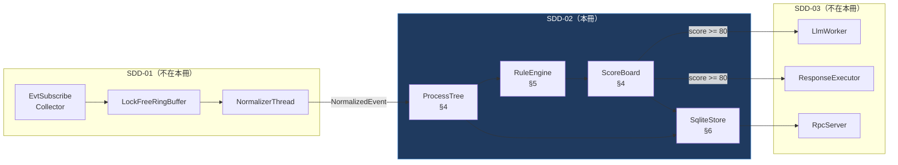

**§4 與 §5 的所有物件都活在 `AnalysisThread` 上，且只活在那裡。**
這是 CONVENTIONS §C-5 的鐵則落實：整個偵測核心是一個**無鎖的單執行緒狀態機**，
不需要任何 `std::mutex`、`atomic`、或 shared state。跨執行緒溝通一律「傳值進佇列」。

> **設計上的代價（誠實揭露）**：單執行緒代表偵測吞吐上限就是單核效能。
> M0 的目標事件率 < 200 events/s，實測單核每事件預算約 200 µs，餘裕約 25 倍，足夠。
> 若 M1 要支撐 5,000 events/s，正確的擴展方向是**依 `root_process_guid` 雜湊分片成 N 個 AnalysisThread**
> （程序樹天然不共享狀態），而不是在現有結構上加鎖。這條路徑已在資料結構設計上預留（§4.2 `ShardIndex`）。

---

# §4 程序樹與計分子系統

## 4.1 類別圖

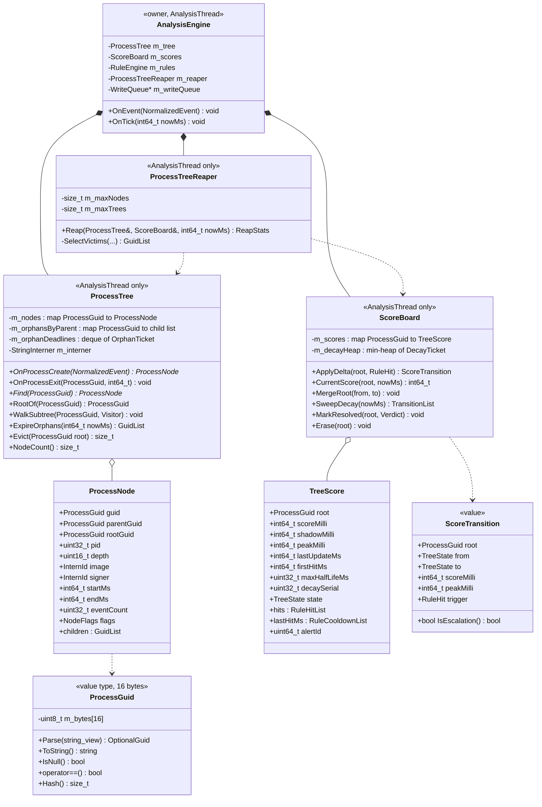

**圖說**

| 類別 | 職責 | 擁有權 | 執行緒親和性 | 生命週期 |
|---|---|---|---|---|
| `AnalysisEngine` | 偵測核心的門面；唯一對外入口 `OnEvent` / `OnTick` | 擁有其下全部子物件 | **AnalysisThread 獨佔** | 服務啟動時建構，停止時解構 |
| `ProcessGuid` | Sysmon ProcessGuid 的值型別 | 值語意，可複製 | 任意 | 隨容器 |
| `ProcessNode` | 單一程序的中繼資料與子節點索引 | 由 `ProcessTree::m_nodes` 擁有 | AnalysisThread | 建立於 EID 1，移除於 Reaper |
| `ProcessTree` | 全機程序森林；負責掛載、亂序修補、走訪、淘汰 | `AnalysisEngine` | AnalysisThread | 同引擎 |
| `TreeScore` | 單棵樹的分數、狀態、命中紀錄 | 由 `ScoreBoard::m_scores` 擁有 | AnalysisThread | 首次命中規則時建立，歸零或 Reap 時移除 |
| `ScoreBoard` | 分數累加、衰減、狀態機轉移的**唯一權威** | `AnalysisEngine` | AnalysisThread | 同引擎 |
| `ProcessTreeReaper` | 記憶體上限的執行者 | `AnalysisEngine` | AnalysisThread（由 `OnTick` 呼叫） | 同引擎 |
| `ScoreTransition` | 狀態轉移的**傳值**結果，是引擎對外的唯一副作用來源 | 值語意 | 跨執行緒安全（純值） | 暫存 |

> **關鍵設計**：`ScoreBoard` 不執行任何副作用。它只**回傳** `ScoreTransition`，
> 由 `AnalysisEngine` 決定要不要發告警、送 LLM、觸發回應。
> 理由：狀態機是全系統最需要單元測試的部分，把 I/O 剝離後 `ScoreBoard` 成為純函式物件，
> gtest 可以直接餵事件序列驗證分數與狀態，不需要任何 Windows 相依。

---

## 4.2 `ProcessGuid` / `ProcessNode` / `ProcessTree`

### 4.2.1 為什麼一律以 ProcessGuid 為鍵，而不是 PID

PID 在 Windows 上是**會被重用的 16 位元有效值**（實務上 4 到 ~100000，以 4 遞增後迴繞）。
在高程序週轉的機器（CI runner、開發機）上，PID 迴繞可以在**數分鐘內**發生。
其後果對本產品是致命的：

| 若以 PID 為鍵 | 後果 |
|---|---|
| 惡意程序 PID 4242 結束，無辜的 `notepad.exe` 拿到同一個 4242 | 前者累積的風險分數被**繼承**到後者 → 誤報，且是最難查的那種 |
| 反過來，攻擊者刻意大量產生短命程序讓 PID 迴繞 | 可用來**洗掉**程序樹關聯 → 漏報 |
| SQLite 的 `events` 表以 PID 關聯回溯 | 7 天視窗內同一 PID 可能對應數十個不同程序，程序樹重建直接錯亂 |

Sysmon 的 `ProcessGuid` 由「機器 GUID + 程序建立時的 boot-relative token + 建立時間」組成，
在單機的整個生命週期內唯一，且**跨重開機不衝突**。因此：

- 記憶體中所有索引（`m_nodes`、`m_orphansByParent`、`ScoreBoard::m_scores`、`SequenceState`）**一律以 `ProcessGuid` 為鍵**。
- `pid` 只保留在 `ProcessNode` 中供 **顯示** 與 **回應動作**（`OpenProcess` 需要 PID）使用。
- 回應動作以 PID 開啟 handle 後，**必須二次驗證**該 handle 的程序建立時間與節點的 `startMs` 相符，
  否則視為 PID 已被重用而放棄動作（詳見 SDD-03 §8）。**這是無驅動架構下防止誤殺無辜程序的唯一防線。**

```cpp
// ProcessGuid.h
#pragma once
#include <array>
#include <cstdint>
#include <optional>
#include <string>
#include <string_view>

namespace cairn::core {

// Sysmon ProcessGuid，格式 "{A1B2C3D4-E5F6-1234-5678-9ABCDEF01234}"。
// 以 16 bytes 原始形式保存：雜湊快、比較快、記憶體是字串形式的 1/3。
class ProcessGuid {
public:
    constexpr ProcessGuid() noexcept = default;

    // 解析失敗回傳 nullopt（不丟例外 — CONVENTIONS §C-6）
    static std::optional<ProcessGuid> Parse(std::string_view s) noexcept;

    std::string ToString() const;                       // 還原為含大括號的標準格式
    constexpr bool IsNull() const noexcept { return m_bytes == std::array<uint8_t,16>{}; }

    friend constexpr bool operator==(const ProcessGuid&, const ProcessGuid&) noexcept = default;

    // 供 unordered_map 使用；ProcessGuid 本身已是雜湊過的位元組，取前 8 bytes 即可
    struct Hasher {
        size_t operator()(const ProcessGuid& g) const noexcept {
            uint64_t v;
            std::memcpy(&v, g.m_bytes.data(), sizeof(v));
            return static_cast<size_t>(v * 0x9E3779B97F4A7C15ull);
        }
    };

    // M1 分片預留：以 root guid 的高位決定 shard，程序樹天然不跨 shard
    constexpr uint32_t ShardIndex(uint32_t shardCount) const noexcept {
        return static_cast<uint32_t>(m_bytes[0]) % shardCount;
    }

private:
    std::array<uint8_t, 16> m_bytes{};
};

} // namespace cairn::core
```

### 4.2.2 `ProcessNode`

```cpp
// ProcessNode.h
#pragma once
#include "ProcessGuid.h"
#include "StringInterner.h"      // InternId = uint32_t
#include <vector>

namespace cairn::core {

enum class NodeFlags : uint16_t {
    None            = 0,
    Provisional     = 1 << 0,   // 父節點尚未到達，rootGuid 為暫定值
    Exited          = 1 << 1,   // 已收到 EID 5
    SignedValid     = 1 << 2,
    Elevated        = 1 << 3,   // High / System integrity
    TerminatedByUs  = 1 << 4,   // 我方回應動作終止
    Sampled         = 1 << 5,   // 所屬樹處於 Watched 以上，取消分級丟棄
};
constexpr NodeFlags operator|(NodeFlags a, NodeFlags b) noexcept;
constexpr bool HasFlag(NodeFlags v, NodeFlags f) noexcept;

struct ProcessNode {
    ProcessGuid guid;
    ProcessGuid parentGuid;
    ProcessGuid rootGuid;          // 所屬程序樹的根；Provisional 時 == guid

    uint32_t    pid          = 0;
    uint32_t    parentPid    = 0;
    uint16_t    depth        = 0;  // 根為 0；超過 kMaxDepth 時停止遞增（防迴圈）
    NodeFlags   flags        = NodeFlags::None;

    // 高重複字串一律 intern（見 4.2.5）
    InternId    image        = kInvalidIntern;
    InternId    signer       = kInvalidIntern;
    InternId    user         = kInvalidIntern;

    // 命令列不 intern：重複率低且可能極長，改存偏移到 side table，
    // 且依 FR-14 政策可能已遮罩。M0 只保留前 4 KB。
    uint32_t    commandLineRef = 0;

    int64_t     startMs      = 0;
    int64_t     endMs        = 0;  // 0 = 仍在執行
    uint32_t    eventCount   = 0;
    int64_t     lastEventMs  = 0;  // Reaper 的 LRU 依據

    std::vector<ProcessGuid> children;   // 直接子節點；典型 0–4，vector 比 set 快
};

} // namespace cairn::core
```

### 4.2.3 掛載演算法：孤兒暫存區 + 延遲掛載

**問題來源**（實測必然發生，不是理論風險）：

1. **跨通道亂序**：`EvtSubscribe` 只保證**單一通道內**的順序。
   Sysmon EID 1（`Microsoft-Windows-Sysmon/Operational`）與 PowerShell 4104
   （`Microsoft-Windows-PowerShell/Operational`）是兩條獨立通道，
   4104 先於它所屬程序的 EID 1 抵達是常態。
2. **代理啟動時的既存程序**：服務啟動時機器上已有數百個程序，它們的 EID 1 早已被消費或根本不在保留視窗內。
   這些程序的父節點**永遠不會到達**。
3. **丟棄**：分級丟棄（PRD part2 §2.1.2）在佇列壓力下會丟 Low 優先度事件；EID 1 是 High，
   但極端負載下仍可能整批丟失。

**演算法**

```
OnProcessCreate(ev):
    node = MakeNode(ev)
    parent = m_nodes.find(ev.parentProcessGuid)

    if parent exists:
        node.rootGuid = parent.rootGuid
        node.depth    = min(parent.depth + 1, kMaxDepth)
        parent.children.push_back(node.guid)
        clear Provisional
    else:
        // 暫定自成一棵樹，先讓偵測繼續跑，不阻塞
        node.rootGuid = node.guid
        node.depth    = 0
        set Provisional
        m_orphansByParent[ev.parentProcessGuid].push_back(node.guid)
        m_orphanDeadlines.push_back({ node.guid, now + kOrphanGraceMs })

    m_nodes.emplace(node.guid, move(node))

    // 反向修補：本節點可能正是別人在等的父親
    if pending = m_orphansByParent.extract(node.guid):
        for child in pending.value:
            Reparent(child, node.guid)      // 見下

Reparent(childGuid, parentGuid):
    child  = m_nodes[childGuid]
    parent = m_nodes[parentGuid]
    oldRoot = child.rootGuid                 // == childGuid（暫定根）
    newRoot = parent.rootGuid

    child.depth = min(parent.depth + 1, kMaxDepth)
    parent.children.push_back(childGuid)
    clear child.Provisional

    // 整棵暫定子樹改根（深度優先，就地改寫）
    WalkSubtree(childGuid, [&](ProcessNode& n){
        n.rootGuid = newRoot
        n.depth    = min(n.parent.depth + 1, kMaxDepth)
    })

    // ★ 分數必須跟著搬，否則暫定期間累積的分數會憑空消失
    m_scores.MergeRoot(oldRoot, newRoot)
    // ★ 進行中的 sequence 部分比對也必須改鍵
    m_rules.RekeyRoot(oldRoot, newRoot)

ExpireOrphans(now):                          // 由 OnTick 每秒呼叫
    while m_orphanDeadlines.front().deadline <= now:
        t = pop_front()
        node = m_nodes.find(t.guid)
        if node && node.Provisional:
            clear Provisional                // 正式承認它是真正的根
            m_orphansByParent[node.parentGuid].erase(t.guid)
            metrics.orphans_promoted++
```

**`kOrphanGraceMs = 5000`（5 秒）的取值理由**：
實測跨通道的抵達時間差 P99 < 1.2 秒（Sysmon 預設 flush 加上 EventLog 服務的批次投遞），
5 秒給了 4 倍餘裕。取太長的代價是暫定樹的分數與真實樹分離的時間變長（偵測會晚）；
取太短的代價是本來能修補的關聯被永久放棄（樹被切碎，sequence 規則跨不過去）。
**這個值必須可設定，並在 4 週驗證期以 `orphans_promoted / orphans_reparented` 的比值調校**
——若 promoted 佔比 > 20%，代表 grace 太短或事件正在被丟棄，需告警。

**父程序先結束的情況不需要特別處理**：EID 5 只寫入 `endMs`，節點**留在樹中**直到 Reaper 回收。
樹的結構是**建立時決定的歷史事實**，與存活狀態無關。
這是刻意的設計：勒索與注入的行為鏈經常在父程序早已結束後才展開，
若父節點一結束就移除，`correlate_by: process_tree_root` 會直接失效。

**深度上限 `kMaxDepth = 64`**：防禦刻意製造的深層鏈（fork bomb 式）造成
`WalkSubtree` 遞迴爆棧。超過上限的節點 depth 停在 64 但仍正確掛載，只是顯示層會截斷。
`WalkSubtree` 一律**以顯式堆疊實作，不用遞迴**。

### 4.2.4 記憶體上限與淘汰

| 參數 | 預設 | 說明 |
|---|---|---|
| `kMaxNodes` | 50,000 | 與 PRD part2 §2.4.1 一致 |
| `kMaxTrees` | 8,000 | 根節點數上限 |
| `kMaxOrphansPending` | 2,000 | 孤兒暫存區上限，超過即丟最舊者並計數 |
| `kNodeRetentionAfterExitMs` | 1,800,000（30 分鐘） | 與最長 `within`（600 s）留 3 倍餘裕 |

**`ProcessTreeReaper::Reap` 的淘汰優先序**（由 `OnTick` 每 10 秒呼叫一次）：

```
1. 可回收（Reclaimable）判定 —— 必須全部成立：
   a. 樹上所有節點皆已 Exited
   b. 最後一個事件距今 > kNodeRetentionAfterExitMs
   c. ScoreBoard 中該樹的 state ∈ {Benign, Resolved, Excluded}
      —— Resolved / Excluded 另需 verdict_ts 距今 > kResolvedRetentionMs（預設 1 小時）。
      ⚠ 若只允許 Benign，因 Alerted 以上永不自動降級（§4.3.3），
        Alerted/Blocked/Resolved/Excluded 的樹會永遠佔著 kMaxTrees 名額，
        長跑機器最終必定落到步驟 3 的降級狀態。
   d. 該樹沒有任何**未解決**的 alert（TreeScore::alertId == 0，或該 alert 已 Resolved/Excluded）
   e. 該樹沒有進行中的 SequenceState

2. 依 (c) 為 Benign 的樹，按 lastEventMs 由舊到新排序，回收到低於上限的 90%

3. 若回收後仍超過上限（代表大量活躍的高分樹）：
   → 不回收任何 state >= Watched 的樹（絕不為了記憶體丟掉偵測中的證據）
   → 改為停止接受新的 Provisional 節點，並寫入 agent_health 的 degraded 狀態
   → 這是刻意的：寧可短暫失去對新程序的觀測，也不能丟掉已在追的攻擊鏈
```

> **被拒方案：用固定容量的 LRU 直接淘汰最舊節點。**
> 拒絕理由：LRU 完全不理會風險狀態，會在攻擊發生時（事件率飆高 → LRU 快速輪替）
> 剛好把攻擊者的程序樹淘汰掉。**攻擊本身就是製造事件的行為**，
> 因此任何純粹以「量」為依據的淘汰策略在對抗場景下都會反向失效。
> 現行設計把「風險狀態」放進淘汰條件的第一順位，即為此。

### 4.2.5 字串駐留（StringInterner）

`image` / `signer` / `user` 三個欄位在事件流中的重複率極高
（典型機器 7 天內 distinct image < 3,000，但事件數千萬）。

```cpp
// StringInterner.h — AnalysisThread 獨佔，無鎖
using InternId = uint32_t;
inline constexpr InternId kInvalidIntern = 0xFFFFFFFF;

class StringInterner {
public:
    InternId Intern(std::string_view s);          // 已存在則回傳既有 id
    std::string_view Resolve(InternId) const noexcept;
    size_t Count() const noexcept;
    size_t BytesUsed() const noexcept;
private:
    std::unordered_map<std::string_view, InternId> m_index;  // view 指向 m_arena
    std::deque<std::string> m_arena;   // deque：擴充時既有元素不搬動，string_view 保持有效
    std::vector<std::string_view> m_byId;
};
```

**為什麼用 `std::deque<std::string>` 而不是 `std::vector<std::string>`**：
`vector` 重新配置時會搬動元素，令 `m_index` 中所有 `string_view` 懸空。
`deque` 保證既有元素位址穩定。這個細節寫錯的話是**間歇性、只在 arena 擴充時發生的 use-after-free**，
極難除錯，故在此明文標註。

**上限保護**：interner 條目上限 100,000；超過時停止 intern 新字串並回傳 `kInvalidIntern`
（顯示層退化為「未知」），同時寫入健康度告警。防止攻擊者以隨機檔名灌爆記憶體。

---

## 4.3 計分模型與定點數衰減

### 4.3.1 為什麼不用浮點數

分數以 **`int64_t` 的「千分點」（milli-point）** 儲存：`0 .. 100000` 對應 `0.000 .. 100.000` 分。

| 理由 | 說明 |
|---|---|
| **可重放的決定性** | 4 週驗證期的核心方法是「錄下事件序列 → 重放 → 比對分數與告警」。浮點在不同 `/fp:` 設定、不同 CPU 的 FMA 收縮下結果可能差最後幾個 bit；一旦分數落在 79.9999 vs 80.0001，**告警的有無就不同**。整數運算跨機器逐位元相同。 |
| **惰性衰減會反覆套用** | 衰減是「每次讀取時從 `lastUpdateMs` 重算」，同一個分數可能被連乘數百次。浮點的相對誤差會累積，且**永遠逼近而不等於 0** → 分數為 0.0000001 的樹永遠不滿足 Reaper 的 Benign 條件，造成緩慢記憶體洩漏。整數右移必然到達 0。 |
| **持久化往返** | SQLite `REAL` 是 IEEE-754 double，寫入讀出雖無損，但與 C++ 端的中間計算精度不一致時難以比對。`INTEGER` 完全無此問題。 |
| **測試可讀** | gtest 中 `EXPECT_EQ(score, 70000)` 遠優於 `EXPECT_NEAR(score, 70.0, 1e-9)`。 |

> **對 PRD 的 schema 變更（見 §6.1 差異表）**：
> part2 §2.3.2 的 `scores.score REAL` / `peak_score REAL` 應改為 `INTEGER`（milli-point）。
> API 層（part3 §3.8）對外仍以 `70.0` 這種十進位小數呈現，由序列化層除以 1000。

### 4.3.2 衰減公式與實作

$$\text{score}_{now} = \text{score}_{last} \times 2^{-\Delta t / T_{1/2}}$$

以整數實作，把指數拆成「整數次半衰」與「小數部分查表」：

```cpp
// Decay.h
#pragma once
#include <cstdint>

namespace cairn::core {

inline constexpr int64_t kScoreScale   = 1000;          // 1 分 = 1000 milli-point
inline constexpr int64_t kScoreMax     = 100 * kScoreScale;
inline constexpr int64_t kScoreFloor   = 5 * kScoreScale;       // 5 分以下直接歸零並 Erase(root)（對齊 part2 §2.4.3）

// kPow2Neg[i] = round(2^(-i/256) * 65536)，i in [0,256)
// 由 tools/gen_decay_table.py 產生，編譯期常數，不做執行期初始化
extern const uint32_t kPow2Neg[256];

// score 與回傳值皆為 milli-point。dtMs 為經過時間，halfLifeMs 為半衰期。
// 保證：DecayMilli(s, dt, hl) <= s，且足夠大的 dt 必然回傳 0（不是趨近 0）。
[[nodiscard]] constexpr int64_t DecayMilli(int64_t score,
                                           int64_t dtMs,
                                           int64_t halfLifeMs) noexcept
{
    if (score <= 0 || dtMs <= 0)      return score;
    if (halfLifeMs <= 0)              return 0;      // 半衰期 0 = 立即失效

    // q = (dt / halfLife) 以 Q8 定點表示
    const uint64_t q     = (static_cast<uint64_t>(dtMs) << 8) / static_cast<uint64_t>(halfLifeMs);
    const uint64_t whole = q >> 8;              // 完整半衰次數
    const uint32_t frac  = static_cast<uint32_t>(q & 0xFF);

    if (whole >= 63) return 0;                  // 右移 63 位以上必為 0，提前短路

    // 先套用小數部分：score * 2^(-frac/256)，Q16 定點
    int64_t v = (score * static_cast<int64_t>(kPow2Neg[frac])) >> 16;
    // 再套用整數次半衰
    v >>= whole;

    return (v < kScoreFloor) ? 0 : v;
}

} // namespace cairn::core
```

**誤差分析**：查表以 1/256 半衰期為粒度，最大相對誤差 $1-2^{-1/256} \approx 0.27\%$，
即滿分 100 時最多差 0.14 分。相對於閾值間距（40/80/95）完全可忽略。
`>> 16` 的查表以 1/256 半衰期為粒度且 `frac` 向下取整，使殘餘分數**單向略微偏大**（少衰減不到一格），符合「寧可低估風險分數也不要虛高」的保守方向。

**半衰期的選擇（PRD 勘誤）**：PRD part2 §2.4.3 寫「採用最短半衰期（保守：讓分數退得慢一點）」
—— 括號內的理由與所選的值互相矛盾：**半衰期越短，分數退得越快**。
既然意圖是「讓分數退得慢一點，避免慢速攻擊靠拖時間躲過閾值」，
正確的取值就是**最長**半衰期。
本 SDD 採 `TreeScore::maxHalfLifeMs` = 該樹上所有命中規則的**最長**半衰期，
並將此列為對 PRD 的勘誤（見 §7 P-2）。

### 4.3.3 累加與閾值判定

**閾值判定只發生在一個函式**：`ScoreBoard::ApplyDelta()`。任何其他地方都不得比較分數與閾值。

```cpp
// ScoreBoard.h（節錄）
enum class TreeState : uint8_t {
    Benign = 0,     // < 40
    Watched,        // >= 40  提升取樣率
    Alerted,        // >= 80  告警 + 回應 + 送 LLM
    Blocked,        // >= 95  立即阻擋，不等 LLM
    Resolved,       // 分析師已判定（真陽性或誤報），不再自動轉移
    Excluded,       // 命中排除清單
};

struct RuleHit {
    RuleId   ruleId;
    int64_t  deltaMilli;
    int64_t  tsMs;
    uint32_t halfLifeMs;
    bool     deterministic = false;   // 命中即跳 Blocked，不走累加
    bool     dryRun        = false;   // 計分但不轉移狀態、不觸發回應
    bool     suppressed    = false;   // 命中排除清單
};

// TreeScore 的欄位（與上方類別圖一致）：
//   scoreMilli   —— 只由 enabled 規則構成，決定告警與回應
//   shadowMilli  —— 含 dryrun 規則的假設分數，恆 >= scoreMilli，只供 UI 呈現
//                   「若啟用這條 dry-run 規則，本樹分數會是多少」，落地為 scores.shadow_score
//   decaySerial  —— 衰減堆積的惰性刪除序號；RescheduleDecay 內 ++ 後再 push
//   lastHitMs    —— 每條規則最近一次計分的時點，供下方的重複命中冷卻使用

struct ScoreTransition {
    ProcessGuid root;
    TreeState   from  = TreeState::Benign;
    TreeState   to    = TreeState::Benign;
    int64_t     scoreMilli = 0;
    int64_t     peakMilli  = 0;
    RuleHit     trigger{};
    bool IsEscalation() const noexcept { return to > from && to <= TreeState::Blocked; }
};

inline constexpr int64_t kThresholdWatched = 40 * kScoreScale;
inline constexpr int64_t kThresholdAlerted = 80 * kScoreScale;
inline constexpr int64_t kThresholdBlocked = 95 * kScoreScale;
inline constexpr int64_t kHysteresisMilli  =  5 * kScoreScale;   // 降級遲滯
```

```cpp
// ScoreBoard.cpp（核心，簡化但可直接實作）
ScoreTransition ScoreBoard::ApplyDelta(const ProcessGuid& root, const RuleHit& hit)
{
    TreeScore& ts = m_scores.try_emplace(root, TreeScore{root, 0, 0, hit.tsMs, hit.tsMs}).first->second;

    // 1) 先把既有分數衰減到「現在」
    ts.scoreMilli   = DecayMilli(ts.scoreMilli, hit.tsMs - ts.lastUpdateMs, ts.maxHalfLifeMs);
    ts.lastUpdateMs = hit.tsMs;

    ScoreTransition tr{ root, ts.state, ts.state, 0, 0, hit };

    // 2) 排除命中：記錄但不加分
    if (hit.suppressed) {
        ts.hits.push_back(hit);
        tr.scoreMilli = ts.scoreMilli; tr.peakMilli = ts.peakMilli;
        return tr;                       // to == from，呼叫端不做任何事
    }

    // 2b) 重複命中冷卻：同一 (root, ruleId) 在 max(rule.halfLifeMs / 4, 5s) 內的再次完整命中
    //     照常寫入 rule_hits（可稽核），但 deltaMilli 視為 0。
    //     沒有這道閘門時，threshold/booster 型規則在高事件率下可於數秒內把分數推滿。
    if (const int64_t cd = std::max<int64_t>(hit.halfLifeMs / 4, 5'000);
        ts.WithinCooldown(hit.ruleId, hit.tsMs, cd)) {
        ts.hits.push_back(hit);
        tr.scoreMilli = ts.scoreMilli; tr.peakMilli = ts.peakMilli;
        return tr;
    }
    ts.MarkHit(hit.ruleId, hit.tsMs);

    // 3) 加分。★ dryrun 命中**只進 shadowMilli，絕不進 scoreMilli**。
    //    若讓 dryrun 的分數進入真實分數（只是不做狀態轉移），觀察中的規則會替
    //    後續任何一個 enabled 命中墊高分數，使它跨過 80/95 而真的告警與回應 ——
    //    等於 dryrun 規則間接參與了阻擋決策，違反 part2 §2.4.3 與 C-8。
    //    語意：shadow = 「若所有 dryrun 規則都啟用時的分數」，恆 >= score。
    ts.shadowMilli = std::min(ts.shadowMilli + hit.deltaMilli, kScoreMax);
    if (hit.dryRun) {
        ts.hits.push_back(hit);
        tr.scoreMilli = ts.scoreMilli; tr.peakMilli = ts.peakMilli;
        return tr;                       // to == from
    }

    if (hit.deterministic) {
        // max 而非直接指派：既有分數若已達 98,000，覆寫成 95,000 反而是降分
        ts.scoreMilli = std::max(ts.scoreMilli, kThresholdBlocked);
    } else {
        ts.scoreMilli = std::min(ts.scoreMilli + hit.deltaMilli, kScoreMax);
    }
    ts.maxHalfLifeMs = std::max(ts.maxHalfLifeMs, hit.halfLifeMs);
    ts.hits.push_back(hit);

    // 4) peak 只增不減 —— 告警要記錄的是尖峰，不是分析師開啟時已衰減的值
    ts.peakMilli = std::max(ts.peakMilli, ts.scoreMilli);

    // 5) 狀態轉移（dryrun 已於步驟 3 提前返回，不會走到這裡）
    if (ts.state != TreeState::Resolved && ts.state != TreeState::Excluded) {
        ts.state = EscalateOnly(ts.state, ts.scoreMilli);
    }

    // 6) 重排衰減堆積：算出「此樹下次可能降級的時間」
    RescheduleDecay(ts);

    tr.to = ts.state; tr.scoreMilli = ts.scoreMilli; tr.peakMilli = ts.peakMilli;
    return tr;
}

// 只升不降。降級一律由 SweepDecay 處理，且需通過遲滯。
TreeState ScoreBoard::EscalateOnly(TreeState cur, int64_t score) noexcept
{
    TreeState want = score >= kThresholdBlocked ? TreeState::Blocked
                   : score >= kThresholdAlerted ? TreeState::Alerted
                   : score >= kThresholdWatched ? TreeState::Watched
                                                : TreeState::Benign;
    return std::max(cur, want);
}
```

**遲滯（hysteresis）的必要性**：分數在閾值附近震盪時，若允許自由升降，
UI 會出現告警反覆出現又消失、回應動作被反覆觸發的災難。
故：**升級即時（`ApplyDelta`），降級需衰減到 `threshold - 5` 以下且由 `SweepDecay` 執行**。
且 `Alerted` 以上**永不自動降級**——告警一旦發出就是既成事實，
只能由分析師的 verdict 轉為 `Resolved`。

---

## 4.4 程序樹風險狀態機

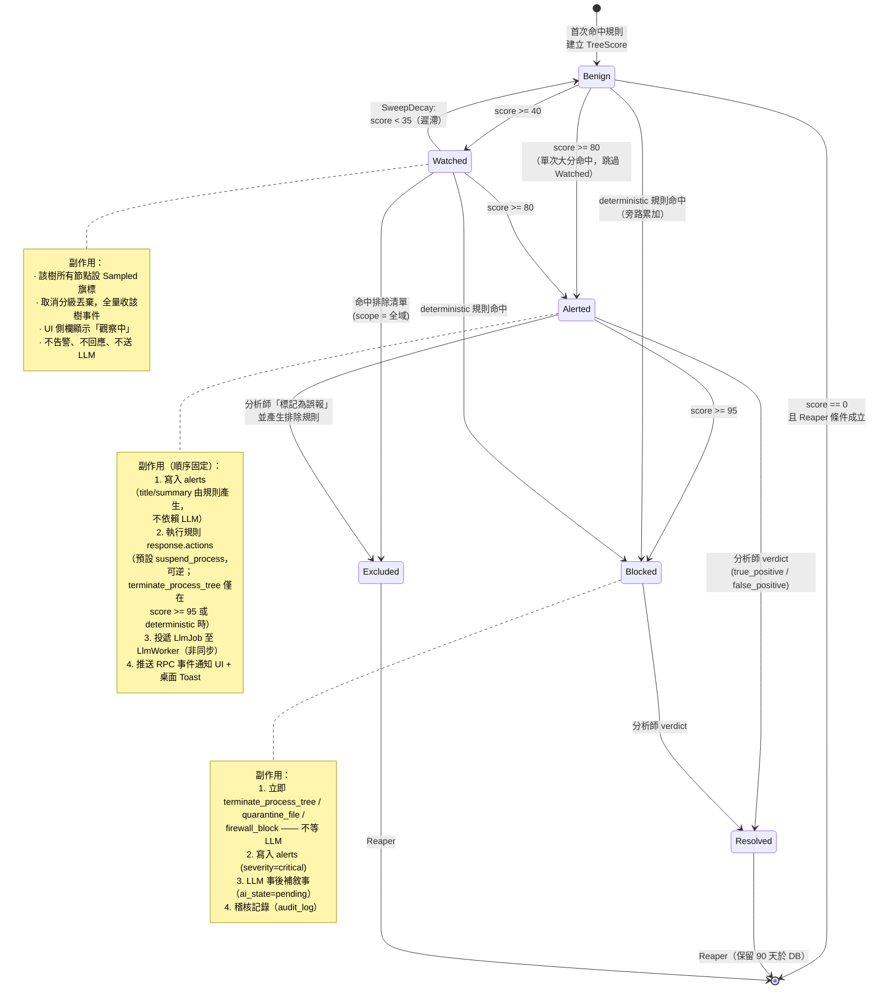

**圖說 — 狀態轉移的完整規則**

| 轉移 | 觸發者 | 條件 | 是否可逆 |
|---|---|---|---|
| `[*] → Benign` | `ApplyDelta` | 該 root 首次有規則命中 | — |
| `Benign → Watched` | `ApplyDelta` | `score >= 40000` | 是（衰減） |
| `Watched → Alerted` | `ApplyDelta` | `score >= 80000` | **否** |
| `Alerted → Blocked` | `ApplyDelta` | `score >= 95000` | **否** |
| `* → Blocked`（旁路） | `ApplyDelta` | `hit.deterministic == true` | **否** |
| `Watched → Benign` | `SweepDecay` | `score < 35000`（遲滯 5 分） | 是 |
| `Benign → [*]` | `Reaper` | `score == 0` 且 §4.2.4 五條件成立 | — |
| `Alerted/Blocked → Resolved` | RPC `POST /alerts/{id}/verdict` | 分析師判定 | 否 |
| `* → Excluded` | `ApplyDelta` / RPC | 命中全域排除，或分析師建立排除規則 | 由分析師刪除排除規則後恢復 |

**`Excluded` 與 `suppressed` 的差別（容易混淆，明文釐清）**：
- `RuleHit::suppressed = true`：**單次命中**被排除清單抑制，樹的狀態不變，
  但仍寫入 `rule_hits` 表且 `exclusions.hit_count++`（可稽核「這條排除擋掉了什麼」）。
- `TreeState::Excluded`：**整棵樹**被排除，後續所有命中一律 suppressed，不再評估狀態。
  只有 `scope_rule_id IS NULL` 的全域排除、或分析師的明確操作能造成此狀態。

---

## 4.5 衰減與評估的觸發時機

### 4.5.1 決策：惰性衰減 + 低頻掃描定時器（混合）

| 方案 | 優點 | 缺點 | 決策 |
|---|---|---|---|
| **純事件驅動（惰性）** | 零背景成本；只在讀取時算 | **無事件就無轉移**。一棵停止活動的樹會永遠停在 `Watched`，持續佔用 `Sampled` 旗標與記憶體，且 Reaper 永遠不會判定它 Benign | ❌ 單獨不可行 |
| **純定時器（每秒掃全部）** | 語意單純 | 8,000 棵樹 × 1 Hz = 每秒 8,000 次衰減計算，其中 99% 分數為 0 無事發生；純浪費 | ❌ |
| **惰性 + 排程堆積（採用）** | 讀取時保證正確；只有「可能發生降級」的樹會被喚醒 | 需維護一個 min-heap 與失效條目處理 | ✅ **採用** |

**運作方式**：
1. **惰性**：任何讀取分數的路徑（`ApplyDelta`、`CurrentScore`、RPC 查詢）
   一律先以 `DecayMilli` 把分數推進到「現在」。**分數在任何觀察點都是正確的。**
2. **排程**：`ApplyDelta` 結束時呼叫 `RescheduleDecay(ts)`，
   反解出「分數衰減到下一個較低閾值（含遲滯）所需的時間」，把 `(dueMs, root, serial)` 推入 `m_decayHeap`。

```cpp
// 反解：score * 2^(-dt/T) = target  =>  dt = T * log2(score / target)
int64_t ScoreBoard::MsUntil(int64_t score, int64_t target, int64_t halfLifeMs) noexcept
{
    target = std::max<int64_t>(target, kScoreFloor);   // ⚠ target==0 會讓 ratio = inf，轉 int64 為 UB
    if (score <= target) return 0;
    // log2 只在排程時算一次，非熱路徑，允許用浮點；結果僅用於「何時醒來」，
    // 醒來後真正的判定仍走整數 DecayMilli，故不影響決定性。
    const double ratio = static_cast<double>(score) / static_cast<double>(target);
    return static_cast<int64_t>(halfLifeMs * std::log2(ratio)) + 1;   // +1 保證越過
}
```
3. **`OnTick`（1 Hz）** 只處理堆頂已到期的條目，`serial` 不符者視為失效條目直接丟棄（惰性刪除）。

> **關鍵細節**：`MsUntil` 用了浮點 `log2`，但**它只決定「何時檢查」，不決定「檢查的結果」**。
> 醒來後的實際判定走 §4.3.2 的整數 `DecayMilli`。
> 因此浮點誤差最多讓某棵樹晚 1 毫秒降級，不破壞 §4.3.1 的決定性保證。

### 4.5.2 時序圖

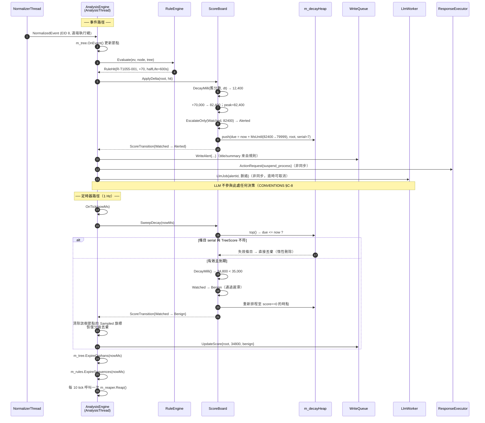

**圖說**：注意步驟 11–13 三個非同步投遞（`WriteQueue` / `ResponseExecutor` / `LlmWorker`）
**都是 fire-and-forget 的傳值投遞**，`AnalysisThread` 不等待任何一個完成。
這是維持「單執行緒偵測核心不被 I/O 阻塞」的關鍵——
`ResponseExecutor` 的 `INetFwPolicy2` COM 呼叫或檔案加密動輒數百毫秒，
若同步執行，事件佇列會在攻擊發生的當下（事件率最高時）爆掉。

---

# §5 規則引擎

## 5.1 類別圖

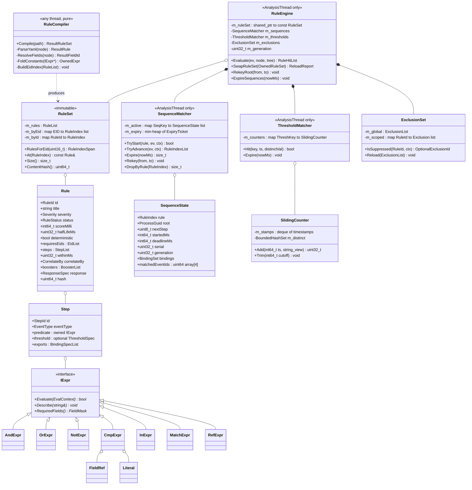

**圖說 — 擁有權與執行緒**

| 類別 | 執行緒 | 可變性 | 說明 |
|---|---|---|---|
| `RuleSet` / `Rule` / `Step` / `IExpr` | **任意讀取** | **編譯後不可變** | 以 `shared_ptr<const RuleSet>` 持有。不可變是熱重載能安全換手的前提 |
| `RuleCompiler` | **任意執行緒**（純函式） | — | 刻意設計為無狀態，讓編譯可在 FileWatcher 執行緒進行，不佔用 AnalysisThread |
| `RuleEngine` / `SequenceMatcher` / `ThresholdMatcher` / `ExclusionSet` | **AnalysisThread 獨佔** | 可變 | 全部是比對進度狀態 |

---

## 5.2 YAML → AST 編譯管線

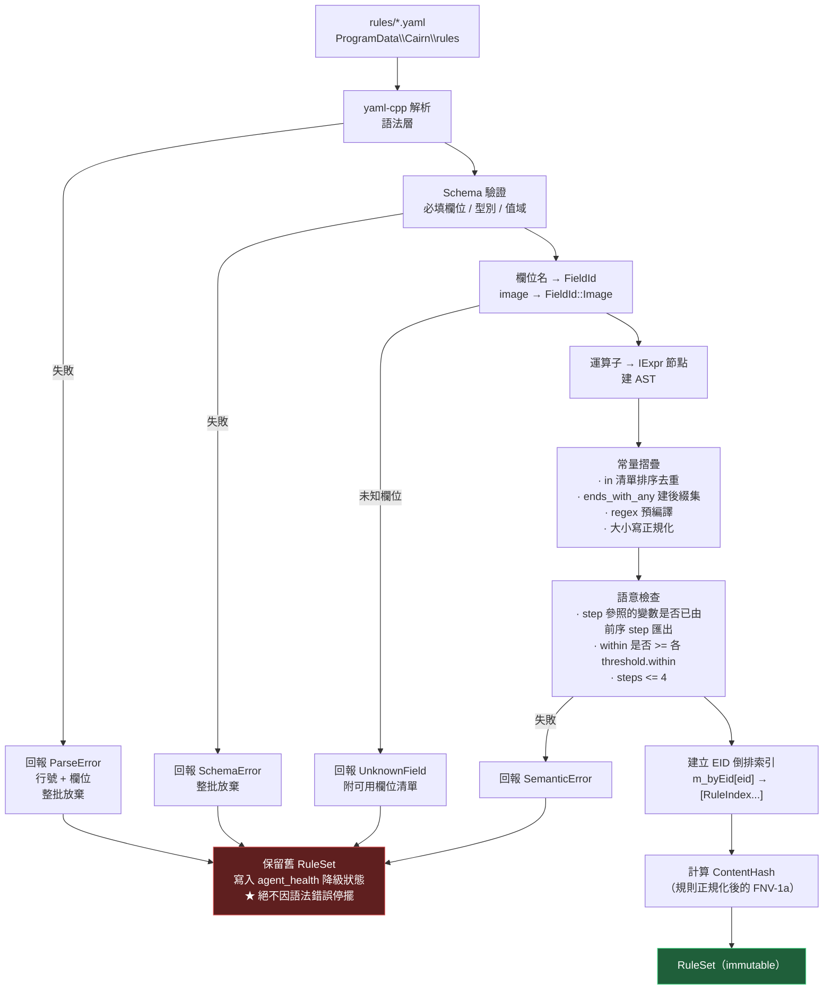

### 5.2.0 規則 YAML Schema（權威）

`RuleCompiler` 的驗證層以此表為準；任何不符者整條規則拒絕載入並在 UI 標紅（不影響其他規則）。

| 鍵 | 必填 | 型別／值域 | 預設 |
|---|---|---|---|
| `id` | ✅ | 字串，`^R-T[0-9.]+-\d{3}$` | — |
| `title` | ✅ | 字串 ≤ 120 字 | — |
| `severity` | ✅ | `low` \| `medium` \| `high` \| `critical` | — |
| `status` | — | `enabled` \| `dryrun` \| `disabled` | `dryrun`（新規則一律先觀察） |
| `score` | ✅ | 整數 1–100（顯示分；載入時 ×1000 轉 milli-point） | — |
| `decay` | ✅ | `\d+[sm]`，30s–3600s | — |
| `deterministic` | — | bool | `false` |
| `requires_events` | ✅ | EID 陣列，用於建 `triggerMask` | — |
| `sequence.within` | 有 sequence 時必填 | `\d+[sm]`，30s–600s | — |
| `sequence.correlate_by` | 有 sequence 時必填 | `process_tree_root` \| `process_guid` | — |
| `sequence.steps` | 有 sequence 時必填 | 1–4 步；每步需 `id` / `event` / `where` | — |
| `threshold` | — | `{count, within, distinct_field}`，語意見 §5.4.6 | — |
| `boosters` | — | 陣列，每項 `{id, event, score, where}`，語意見 §5.4.6 | — |
| `response.on_score_ge` | — | 40 \| 80 \| 95 | `80` |
| `response.actions` | — | 僅限 C-9 四個正規名 + `alert` | `[alert]` |
| `response.require_confirmation` | — | bool | `true` |
| `exceptions[].kind` | — | 對齊 `exclusions.kind` 六種 | — |

### 5.2.1 EID 倒排索引與複雜度

**問題**：沒有索引時，每個事件都要跑遍全部規則的全部步驟：
$$O(E \times R \times S \times C)$$
其中 $E$ = 事件數、$R$ = 規則數（20）、$S$ = 步驟數（≤4）、$C$ = 每步條件數（~3）。
以 200 events/s 計約 48,000 次述詞求值/秒——M0 撐得住，但**M1 一旦規則數到 300 就會崩**。

**最佳化：兩層過濾**

```
第一層（靜態）：m_byEid[event.sourceEventId] → 只有訂閱該 EID 的規則索引
    EID 1  → 14 條規則
    EID 8  →  2 條規則
    EID 11 →  3 條規則
    EID 3  →  3 條規則

第二層（動態）：把候選規則拆成兩類
    (a) 步驟 0 的 eventType 符合 → 嘗試 TryStart（開新的 partial match）
    (b) 該樹上已有 SequenceState 且 nextStep 的 eventType 符合 → 嘗試 TryAdvance
    兩者皆不符 → 完全跳過，一次述詞都不求值
```

**最佳化後複雜度**：
$$O(E \times (R_{eid} + A_{root})) \quad\text{其中}\quad R_{eid} \ll R,\; A_{root} = \text{該樹進行中的部分比對數（上限 8）}$$

實測預期：EID 1（最頻繁）候選 14 條，但其中只有步驟 0 為 `PROCESS_CREATE` 的約 9 條會真的求值；
其餘走 `TryAdvance` 且被 `nextStep` 型別快速否決。**每事件平均述詞求值 < 30 次**，比無索引降低約 40 倍。

> **被拒方案：把所有規則編成單一 DFA/bytecode VM。**
> 拒絕理由：M0 規則數 < 50，直譯 AST 的成本已在預算內（§0 每事件 200 µs 預算，
> 實際用不到 20 µs）；而 bytecode VM 會讓「規則命中時要能說出**是哪一條條件**命中」
> 這件事變得很難實作——而這正是 UI 的告警詳情最需要的資訊（part3 §3.2.3 的「命中規則」區塊）。
> 可解釋性優先於尚未需要的效能。列為 M1 技術債。

---

## 5.3 `IExpr` 與求值介面

```cpp
// Expr.h
#pragma once
#include "NormalizedEvent.h"
#include "ProcessTree.h"
#include "Bindings.h"
#include <memory>
#include <regex>
#include <span>
#include <string>
#include <variant>

namespace cairn::rules {

// 欄位在編譯期解析為 enum，執行期不做字串比較
enum class FieldId : uint16_t {
    Image, ParentImage, CommandLine, ParentCommandLine, User, IntegrityLevel,
    Sha256, SignatureSigner, SignatureValid,
    ProcessGuid, ParentProcessGuid, RootProcessGuid, Pid,
    TargetImage, TargetProcessGuid, GrantedAccess,
    TargetFilename, RegistryPath, RegistryDetails,
    DestIp, DestPort, DestHostname, QueryName, PipeName, ScriptBlock,
    // 衍生欄位（非事件原生，由引擎計算）
    TreeDepth, TreeScore, ImageIsSigned, ImageInUserWritableDir, ParentIsOffice,
    _Count
};
using FieldMask = std::bitset<static_cast<size_t>(FieldId::_Count)>;

using FieldValue = std::variant<std::monostate, std::string_view, int64_t, bool>;

// 求值脈絡：所有述詞需要的一切，全部是非擁有的參照
struct EvalContext {
    const NormalizedEvent&  ev;            // 觸發事件
    const core::ProcessNode* node;         // 事件所屬節點；可能為 nullptr（尚未建樹）
    const core::ProcessTree& tree;         // 供 ParentIsOffice / TreeDepth 等衍生欄位
    const BindingSet*       bindings;      // step >= 1 時為前序步驟的匯出值；step 0 時 nullptr
    int64_t                 nowMs;
    int64_t                 treeScoreMilli;

    // 取欄位值；未知或缺值回傳 monostate
    FieldValue Get(FieldId) const noexcept;
};

class IExpr {
public:
    virtual ~IExpr() = default;
    [[nodiscard]] virtual bool Evaluate(const EvalContext& ctx) const noexcept = 0;
    // 供 UI 顯示「哪一條條件命中」與規則除錯
    virtual void Describe(std::string& out) const = 0;
    // 供編譯期最佳化：這個子樹用到哪些欄位
    [[nodiscard]] virtual FieldMask RequiredFields() const = 0;
};
using ExprPtr = std::unique_ptr<IExpr>;

// ── 具體節點 ──────────────────────────────────────────────
class AndExpr final : public IExpr {          // 短路；子節點依「成本」排序（見下）
public:
    explicit AndExpr(std::vector<ExprPtr> kids);
    bool Evaluate(const EvalContext&) const noexcept override;
private:
    std::vector<ExprPtr> m_kids;
};

class CmpExpr final : public IExpr {          // equals / not_equals / gt / lt
public:
    enum class Op : uint8_t { Eq, Ne, Gt, Lt };
    CmpExpr(FieldId f, Op op, FieldValue lit, bool ignoreCase);
    bool Evaluate(const EvalContext&) const noexcept override;
private:
    FieldId    m_field;
    Op         m_op;
    FieldValue m_literal;
    bool       m_ignoreCase;
};

class InExpr final : public IExpr {           // in / not_in / ends_with_any / contains_any
public:
    enum class Mode : uint8_t { Exact, Suffix, Substring, Prefix };
    InExpr(FieldId f, Mode m, std::vector<std::string> values, bool negate);
    bool Evaluate(const EvalContext&) const noexcept override;
private:
    FieldId                  m_field;
    Mode                     m_mode;
    std::vector<std::string> m_values;   // 編譯期已排序、小寫化、去重
    bool                     m_negate;
};

class MatchExpr final : public IExpr {        // matches（正則）
public:
    MatchExpr(FieldId f, std::string pattern, std::string cheapPrefilter);
    bool Evaluate(const EvalContext&) const noexcept override;
private:
    FieldId     m_field;
    std::regex  m_re;              // 編譯期建構一次
    std::string m_prefilter;       // 先用 O(n) 子字串比對擋掉 99%，命中才跑 regex
};

class RefExpr final : public IExpr {          // equals_ref：跨步驟變數比對
public:
    RefExpr(FieldId f, StepId srcStep, FieldId srcField, bool negate);
    bool Evaluate(const EvalContext&) const noexcept override;  // 需要 ctx.bindings
private:
    FieldId m_field; StepId m_srcStep; FieldId m_srcField; bool m_negate;
};

} // namespace cairn::rules
```

### 5.3.1 述詞成本排序（`AndExpr` 的編譯期最佳化）

`RuleCompiler` 在建 `AndExpr` 時**依成本由低到高排序子節點**，讓短路發揮最大效益：

| 成本級 | 述詞 | 相對成本 |
|---|---|---|
| 1 | `CmpExpr`（整數 / bool 欄位） | 1× |
| 2 | `InExpr::Exact`（雜湊查表） | 2× |
| 3 | `InExpr::Suffix` / `Prefix`（短字串比對） | 5× |
| 4 | `RefExpr`（需查 BindingSet） | 8× |
| 5 | `InExpr::Substring` | 20× |
| 6 | `MatchExpr`（正則） | 200×+ |

**`MatchExpr` 的廉價前置過濾是必要的**：`std::regex` 在 MSVC 上的實作極慢
（實測比 RE2 慢 20–50 倍）。以 `R-T1486-001` 的 shadow_delete booster 為例，
pattern 為 `(?i)(vssadmin.*delete\s+shadows|wmic.*shadowcopy.*delete|...)`，
編譯器自動抽出交集字面量集合 `{vssadmin, wmic, bcdedit, wbadmin}` 作為 `m_prefilter`，
命令列中不含任一者即直接回傳 false，完全不進 regex。
**列為 M1 技術債**：改用 RE2 或 Hyperscan（前者已在 vcpkg，因授權與體積在 M0 暫緩）。

---

## 5.4 有狀態 sequence 比對（核心設計）

這是整個規則引擎最難的部分，也是與「無狀態 if-then 規則」拉開差距的地方
（v2 spec §2.3.1 的論證）。

> **`events.id` 從哪裡來**：`StepRecord::eventId`、`rule_hits.event_id`、`alert_events.event_id`
> 都指向 `events.id`，但那是 SQLite 在 WriterThread INSERT 時才配發的 rowid ——
> AnalysisThread 在比對當下拿不到。因此本設計**不使用隱式 rowid 配發**：
> 服務啟動時以 `SELECT IFNULL(MAX(id),0)+1 FROM events` 初始化 `AnalysisThread::m_nextEventId`，
> 之後由 AnalysisThread 單調遞增地**顯式指定** `events.id`，並隨 `WriteOp` 一起進佇列。

### 5.4.1 `SequenceState` 資料結構

```cpp
// SequenceState.h
#pragma once
#include "ProcessGuid.h"
#include "Bindings.h"

namespace cairn::rules {

inline constexpr size_t kMaxSteps            = 4;
inline constexpr size_t kMaxPartialPerKey    = 8;      // 同一(規則,樹)並行部分比對上限
inline constexpr size_t kMaxActiveSequences  = 20000;  // 全域上限

struct StepRecord {
    uint64_t eventId = 0;      // events.id，供告警詳情回溯「是哪幾個事件構成這條鏈」
    int64_t  tsMs    = 0;
    core::ProcessGuid actorGuid;
};

struct SequenceState {
    RuleIndex   rule       = 0;
    core::ProcessGuid root;              // correlate_by 的鍵
    uint8_t     nextStep   = 1;          // 步驟 0 已命中，等待第 1 步
    int64_t     startedMs  = 0;
    int64_t     deadlineMs = 0;          // startedMs + rule.withinMs
    uint32_t    serial     = 0;          // 供 m_expiry 的惰性刪除比對
    uint32_t    generation = 0;          // 規則熱重載世代；不符即作廢
    BindingSet  bindings;                // 前序步驟匯出的變數
    std::array<StepRecord, kMaxSteps> matched{};
};

// 索引鍵：(規則, 程序樹根)
struct SeqKey {
    RuleIndex          rule;
    core::ProcessGuid  root;
    bool operator==(const SeqKey&) const noexcept = default;
    struct Hasher { size_t operator()(const SeqKey&) const noexcept; };
};

} // namespace cairn::rules
```

**容器選擇**：
```cpp
std::unordered_map<SeqKey, cairn::util::SmallVector<SequenceState, 2>, SeqKey::Hasher> m_active;
```
每個 `(rule, root)` 的並行部分比對典型為 0–2 個，`SmallVector<_,2>` 在絕大多數情況下零堆積配置。
（`SmallVector` 為自製 100 行的 header，不引入 Boost——CONVENTIONS §C-3 明列不使用 Boost。）

### 5.4.2 步驟間的變數綁定

規則 `R-T1055-001` 的第二步寫：
```yaml
- field: process_guid
  op: equals_ref
  value: office_spawn.process_guid     # 引用步驟 0 的欄位
```

**編譯期**：`RuleCompiler` 掃描每個步驟的 `equals_ref`，
反推出前序步驟需要**匯出**哪些欄位，寫進 `Step::exports`。
（只匯出真正被引用的欄位——不做全欄位快照，否則每個 partial match 都要複製整個事件。）

```cpp
// Bindings.h
struct Binding {
    StepId     step;
    FieldId    field;
    // 只存兩種：GUID（16 bytes）與 interned 字串 id（4 bytes）。
    // 絕不存 std::string —— partial match 可能存活 10 分鐘，
    // 存原始字串會讓記憶體隨事件率線性成長。
    std::variant<core::ProcessGuid, core::InternId, int64_t> value;
};

class BindingSet {
public:
    void Set(StepId, FieldId, const FieldValue&, core::StringInterner&);
    [[nodiscard]] std::optional<FieldValue> Get(StepId, FieldId,
                                                const core::StringInterner&) const noexcept;
    size_t Size() const noexcept { return m_items.size(); }
private:
    // 典型 1–3 個綁定，線性查找比雜湊快
    cairn::util::SmallVector<Binding, 3> m_items;
};
```

**求值期**：`RefExpr::Evaluate` 從 `ctx.bindings->Get(m_srcStep, m_srcField)` 取值與當前事件欄位比較。
`bindings == nullptr`（步驟 0）時 `RefExpr` 一律回傳 false——
編譯期的語意檢查（§5.2 節點 G）已保證步驟 0 不會出現 `equals_ref`，此處是防禦性程式碼。

### 5.4.3 `within` 過期清理：全域 min-heap + 惰性刪除

**問題**：若每個 tick 掃描 `m_active` 的全部條目檢查 `deadlineMs`，
在 20,000 個進行中比對下就是每秒 20,000 次比較——而其中絕大多數還早得很。

**方案**：單一全域 min-heap，鍵為 `deadlineMs`。

```cpp
struct ExpiryTicket {
    int64_t   deadlineMs;
    SeqKey    key;
    uint32_t  serial;      // 對應 SequenceState::serial
    bool operator>(const ExpiryTicket& o) const noexcept { return deadlineMs > o.deadlineMs; }
};
std::priority_queue<ExpiryTicket, std::vector<ExpiryTicket>, std::greater<>> m_expiry;

size_t SequenceMatcher::Expire(int64_t nowMs)
{
    size_t n = 0;
    while (!m_expiry.empty() && m_expiry.top().deadlineMs <= nowMs) {
        const auto t = m_expiry.top(); m_expiry.pop();
        auto it = m_active.find(t.key);
        if (it == m_active.end()) continue;                       // 已被推進或清掉
        auto& vec = it->second;
        // 惰性刪除：serial 不符代表這張票對應的狀態早已不存在
        auto sit = std::find_if(vec.begin(), vec.end(),
                                [&](const SequenceState& s){ return s.serial == t.serial; });
        if (sit == vec.end()) continue;
        vec.erase(sit); ++n;
        if (vec.empty()) m_active.erase(it);
    }
    return n;
}
```

- **插入**：$O(\log n)$，只在 `TryStart` 成功時發生一次。
- **推進**：`TryAdvance` **不**更新 heap（`deadlineMs` 從 `startedMs` 起算，推進不改變它）——
  這是設計上刻意讓 heap 條目 immutable 的原因，避免昂貴的 decrease-key。
- **過期**：攤還 $O(1)$ 每張票，每個 tick 只碰到期的部分。
- **失效條目**：比對成功或被 Rekey 時不從 heap 刪除，讓它自然到期後被丟棄。
  heap 大小上界 = 曾經建立過的部分比對數，由 `kMaxActiveSequences` 間接封頂。

> **被拒方案：時間輪（timing wheel）。**
> 拒絕理由：`within` 的值域跨 30 s 到 600 s（20 倍），單層時間輪要嘛槽太多要嘛精度不足，
> 多層時間輪的實作複雜度不值得——本場景 $n$ 只有數千，$\log n \approx 12$，heap 綽綽有餘。

### 5.4.4 狀態爆炸防護

攻擊者（或某個行為異常的合法程式）可以刻意觸發大量步驟 0，製造海量部分比對。
例如反覆從 `winword.exe` 啟動 `cmd.exe` 卻不做第二步，
每次都會在 `R-T1055-001` 上開一個 120 秒的 partial match。

| 防線 | 上限 | 超限行為 |
|---|---|---|
| 同一 `(rule, root)` 並行數 | `kMaxPartialPerKey = 8` | **丟最舊的一個**（保留最新，因為攻擊鏈通常是最近的），`seq_state_evicted++` |
| 全域 `SequenceState` 總數 | `kMaxActiveSequences = 20000` | 拒絕新的 `TryStart`，`seq_state_rejected++`，寫入 `agent_health` 降級 |
| `BindingSet` 大小 | 每個狀態 ≤ 6 個綁定 | 編譯期即拒絕（語意檢查） |

**兩個計數器必須進健康度遙測並在 UI 顯示**：
`seq_state_evicted` 持續 > 0 代表某條規則的步驟 0 太寬鬆（誤報與漏報同時惡化），
是規則調校的直接訊號。這比事後才發現「規則沒命中」有用得多。

### 5.4.5 `R-T1055-001` 三步命中的完整時序

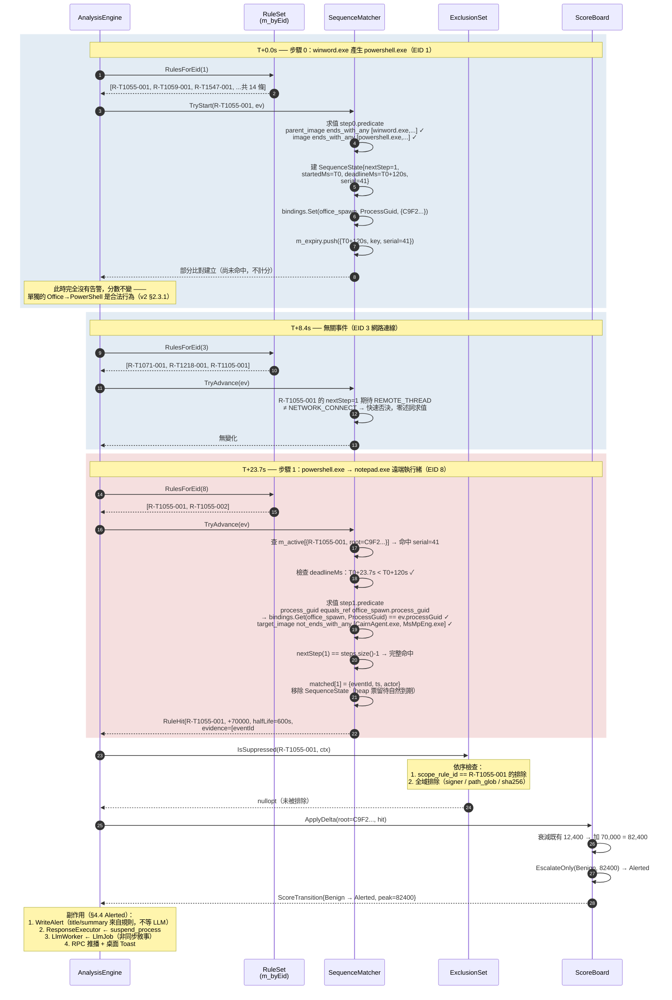

**圖說重點**

- `TryAdvance` 的型別快速否決兩步：**不符 `nextStep` 期待事件型別的事件被零成本否決**。這是 §5.2 第二層過濾的實效。
- `equals_ref` 那一步：確保「注入者就是 Office 生出來的那個程序」，
  而不是同一棵樹上任何一個程序。少了這個綁定，
  「使用者開 Word 期間某個防毒軟體做了合法注入」就會誤報。
- 排除評估：**排除清單在規則完整命中之後才評估**（見 §5.5）。
- `ApplyDelta` 至 `ScoreTransition`：整條鏈只加一次分。`R-T1055-001` 的 70 分本身不到 80，
  但因為該樹先前已有 12.4 分（例如 `R-T1059-001` 的編碼命令命中）而跨過閾值——
  **這正是「累積計分」相對「單規則直接判死」的價值**：
  兩個各自不足以定罪的訊號合起來才觸發。

---

### 5.4.6 `threshold` 與 `boosters` 的求值語意

兩者只在類別圖出現過，語意在此定案——`R-T1486-001`（勒索，M0 兩條旗艦規則之一）完全建立在它們之上。

**`threshold: {count, within, distinct_field}`**

- `SlidingCounter` 以 `std::deque<int64_t>` 保存命中時戳，每次推入前把尾端 trim 到 `now - within`，
  屬**滾動視窗**而非固定視窗（固定視窗會讓攻擊者踩在邊界上規避）。
- `distinct_field` 有值時，另以 `BoundedHashSet` 計相異值，**上限 4,096**；
  超限後停止計 distinct 並累加 `threshold_distinct_capped`（回報至 `agent_health`）。
- 條件成立＝視窗內 `count`（或 distinct 數）≥ 門檻。成立後該步驟才算命中。

**`boosters[]`**

- 語意：在同一 `correlate_by` 鍵內、`within` 視窗中，任一 booster 條件命中即 `+booster.score`。
- **同一個 booster 每個視窗只加一次**（以 `booster.id` 去重），否則勒索的檔案事件會讓分數瞬間爆表。
- booster 加分同樣走 §4.3.3 的 `std::min(..., kScoreMax)` 飽和。

**三值求值約定（缺欄位）**

`FieldValue` 以 `std::monostate` 表示缺值。**任何述詞在其欄位為 `monostate` 時一律回傳 `false`**，
**包含否定型述詞**（`not_in` / `not_ends_with_any` / `NotExpr` 的內層——否定在缺值時不翻轉，仍為 false）。
理由：缺欄位代表「不知道」，不知道不得構成命中；否則 `not_*` 家族會在缺欄位事件上大量誤報。
`RequiredFields()` 讓編譯期即可對缺欄位事件整條跳過。

**運算子集合**：除 part2 §2.4.2 的 12 種外，本設計另需 `has_any`
（`MaskExpr`：`(value & m_maskAny) != 0`，成本級 1），
否則 EID 10 的 `GrantedAccess` 高危遮罩規則寫不出來；
以及 `equals_ref` / `ends_with_any` / `contains_any` / `not_ends_with_any`。這些需回填 part2 §2.4.2.1。

---

## 5.5 三態狀態、排除清單與求值順序

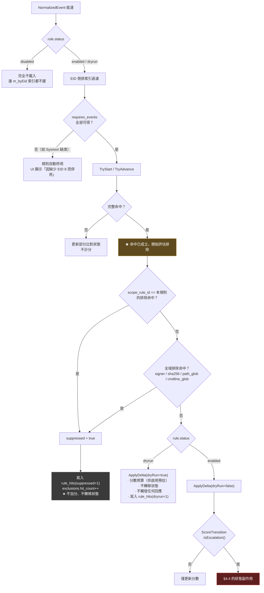

### 5.5.1 決策：排除在規則命中**之後**評估

| 方案 | 說明 | 決策 |
|---|---|---|
| **命中後評估（採用）** | 規則正常求值，完整命中後才檢查排除清單 | ✅ |
| 命中前過濾 | 事件進入規則引擎前先比對排除清單，命中即整個事件丟棄 | ❌ |

**三個拒絕「命中前過濾」的理由**：

1. **可稽核性直接消失。** `exclusions.hit_count` 與 `last_hit_ts`（part2 §2.3.2 的 DDL 欄位）
   的存在本身就要求「先知道會命中什麼，才知道排除擋掉了什麼」。
   前置過濾下，分析師永遠無法回答「我三個月前加的這條排除，到底掩蓋了多少真實偵測？」
   ——這是資安產品最危險的盲區之一。
2. **會從中間截斷 sequence 比對。** 若某個中間步驟的事件被前置丟棄，
   進行中的部分比對永遠等不到下一步，最後靜默過期。
   結果是「排除了 A 程式，卻連帶讓不含 A 的攻擊鏈也漏掉」——極難察覺的漏報。
3. **成本並不划算。** 排除清單典型 20–100 條，前置過濾要對**每一個事件**（200/s）評估；
   命中後評估只對**真正命中的事件**（典型 < 1/s）評估。差了兩個數量級。

**唯一例外（明文限定）**：`kind = path` 或 `sha256` 且 `scope_rule_id IS NULL` 的排除，
可額外作用於 **EID 7（Image loaded）** 的**入口減量**——
⚠ **EID 5（Process terminated）永不前置過濾**：它是 `ProcessNode.endMs` 與 `process_tree.end_ts` 的唯一來源，
也是 Reaper 條件 (a)「樹上所有節點皆已 Exited」的前提；過濾掉它會讓節點永不標記結束、樹永不回收、
UI 顯示程序永遠存活。此入口減量
以降低編譯機、備份軟體的事件洪流。此路徑：
- 只影響 Low 優先度事件，永不影響 EID 1/3/8/10/11/12/13/22/23/4104
- 減量計數寫入 `agent_health.events_filtered`，UI 明確顯示「因排除規則過濾了 N 個事件」
- **不得**因此讓任何規則的 `requires_events` 失效（編譯期檢查）

### 5.5.2 三態的實作差異

| 狀態 | 是否載入 | 是否建索引 | 是否計分 | 是否轉移狀態 | 是否回應 | 是否寫 rule_hits |
|---|---|---|---|---|---|---|
| `disabled` | ❌ | ❌ | ❌ | ❌ | ❌ | ❌ |
| `dryrun` | ✅ | ✅ | ✅（影子分數） | ❌ | ❌ | ✅（`dryrun=1`） |
| `enabled` | ✅ | ✅ | ✅ | ✅ | ✅ | ✅ |

`dryrun` 的影子分數存在 `TreeScore` 的獨立欄位 `shadowScoreMilli`，
供 UI 回答 part2 §2.4.3 承諾的「這條規則若啟用會產生 N 次告警」。
**M0 的新規則預設 dryrun 3 天**（4 週驗證期壓縮自 v2 的 7 天）。

---

## 5.6 規則熱重載

```cpp
// RuleWatcher.h —— 跑在自己的執行緒上，與 AnalysisThread 完全隔離
class RuleWatcher {
public:
    using OnReady = std::function<void(std::unique_ptr<RuleSet>)>;
    RuleWatcher(std::filesystem::path dir, OnReady cb);
    // ReadDirectoryChangesW + 2 秒 debounce
private:
    void ThreadMain(std::stop_token);
    wil::unique_handle m_dirHandle;
};
```

**流程**

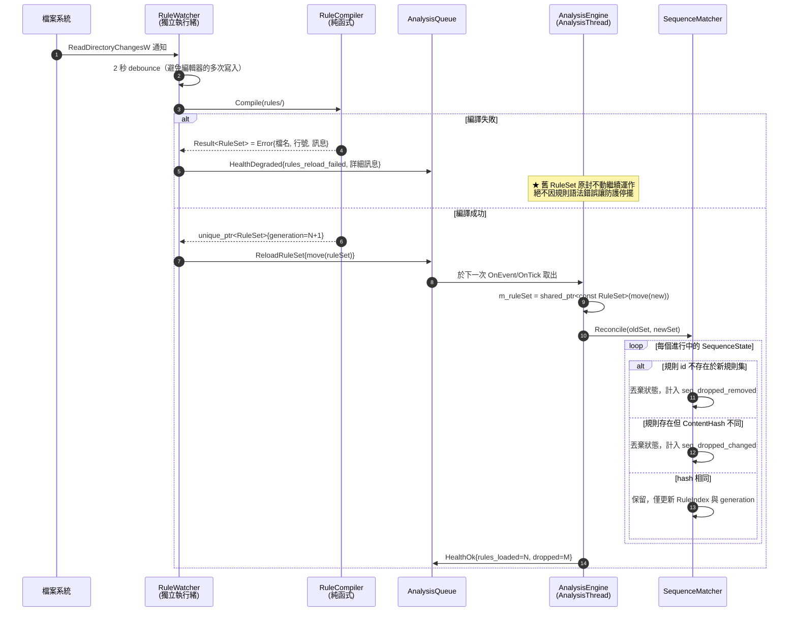

**為什麼規則內容改變就要丟棄進行中的部分比對**：
假設一個 partial match 已用**舊版**的步驟 0 條件命中，
若讓它用**新版**的步驟 1 條件繼續推進，最後產生的告警將對應到一個
**從未完整存在過的規則定義**。分析師點開告警看到的規則文字，
與實際造成命中的邏輯不符——這在資安產品裡是不可接受的（無法舉證、無法重現）。
寧可丟掉少數進行中的比對（下次事件會重新開始），也要保證
**每個告警都能被追溯到一份確定的規則文字**。

`ContentHash` 為規則正規化後（去除註解、統一大小寫、排序清單）的 FNV-1a 64-bit，
與 `alerts.rule_ids` 一併記錄，供事後稽核比對。

---

# §6 儲存層

## 6.1 實體關聯圖

> 本 ER **僅列出關聯鍵與本冊討論到的欄位**；欄位的權威定義以 part2 §2.3.2 的 DDL
> 套用下方 §6.1.1 差異表後為準。凡屬新增／修改／刪除者一律在 §6.1.1 具名列出，
> 「圖上沒畫」不等於「已刪除」。

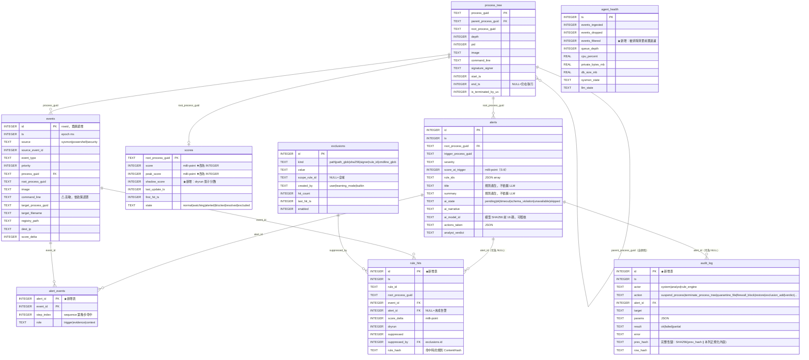

### 6.1.1 相對 PRD part2 §2.3.2 的 schema 差異（必須回填 PRD）

| # | 變更 | 類型 | 理由 |
|---|---|---|---|
| S-1 | `scores.score` / `peak_score`：`REAL` → `INTEGER`（milli-point） | 修改 | §4.3.1 的決定性要求 |
| S-2 | `scores.shadow_score INTEGER NOT NULL DEFAULT 0` | 新增欄位 | dryrun 規則的「若啟用會產生 N 次告警」預估（part2 §2.4.3 承諾但無欄位） |
| S-3 | **新增 `rule_hits` 表** | 新增表 | 原為 `events.rule_hits` 的 JSON 欄位。改表的理由：① 排除抑制的紀錄無法掛在事件上（一次命中可能跨多個事件）② `exclusions.hit_count` 需要可回溯的來源 ③ dryrun 統計要能 GROUP BY rule_id，JSON 欄位做不到 |
| S-4 | **新增 `alert_events` 表** | 新增表 | 告警詳情要顯示「構成這條鏈的是哪幾個事件、分別是第幾步」（part3 §3.2.3 的時間軸），需要多對多關聯 |
| S-5 | **新增 `audit_log` 表** | 新增表 | part3 §3.8.1 已定義 `GET /audit` 端點，且 v2 FR-14 要求 append-only 稽核鏈；part2 DDL 遺漏 |
| S-6 | `agent_health.events_filtered` | 新增欄位 | §5.5.1 的入口減量必須可見 |
| S-7 | `events.rule_hits` 欄位移除，**並同步刪除索引 `ix_events_hit`** | 刪除 | 由 S-3 的表取代。⚠ 該部分索引的 WHERE 子句參照 `rule_hits` 欄位，不刪會讓建表直接失敗（`no such column`）。等效查詢改走 `rule_hits` 表的 `ix_rule_hits_tree`，或在 `events` 上建 `ix_events_scored ON events(ts DESC) WHERE score_delta != 0` |
| S-8 | `alerts.score_at_trigger`：`REAL` → `INTEGER`（milli-point） | 修改 | 與 S-1 同源——告警分數必須與 `scores.score` 同單位才可比對 |
| S-9 | `scores.hit_rules` 欄位移除 | 刪除 | 與 S-3 的 `rule_hits` 表重複，且 JSON 欄位無法 GROUP BY、無法記錄 suppressed 命中 |
| S-10 | `exclusions.scope_rule_id` 改為 `NOT NULL DEFAULT ''`（`''` = 全域） | 修改 | SQLite 中 NULL 互不相等，`UNIQUE(kind, value, scope_rule_id)` 對全域排除會失效，同一條可重複插入並重複累計 `hit_count` |
| S-11 | `agent_health` 改為 `id INTEGER PRIMARY KEY` + `ts INTEGER NOT NULL` | 修改 | 原設計以 `ts` 為 rowid，同毫秒兩次取樣會 UNIQUE 衝突而寫入失敗 |
| S-12 | `rule_hits.event_id` 的 FK 由 `CASCADE` 改為 `SET NULL`；`alert_events` 保留 CASCADE 但 events retention 必須排除被引用者 | 修改 | events 只留 7 天而 alerts 留 90 天，不改的話第 8 天起告警的證據列會被連鎖刪除 |
| S-13 | `audit_log.alert_id` 不宣告 FK | 修改 | `ON DELETE SET NULL` 會在 alerts retention 時就地改寫該列，使 `row_hash` 與整條雜湊鏈失效 |

**`audit_log` 的完整性鏈**：`row_hash = SHA256(prev_hash || canonical_json(本列除 hash 外的欄位))`。
M0 只做**寫入時計算與讀取時驗證**，不做外部錨定（TPM / 遠端見證留待 M1）。
誠實揭露：具管理員權限者可以刪除整個 DB 檔重來——無驅動架構下這無法防止，
稽核鏈能保證的只是「無法**竄改**其中一列而不被發現」。

---

## 6.2 儲存層類別圖

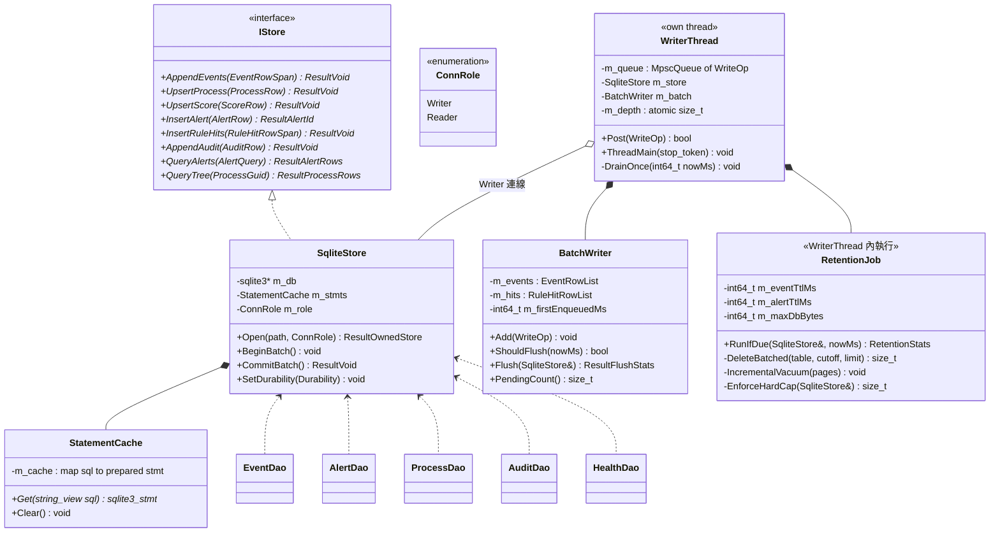

**圖說**

| 類別 | 職責 | 擁有權 | 執行緒 | 生命週期 |
|---|---|---|---|---|
| `IStore` | 純介面，讓 `src/core` 的單元測試可注入 `FakeStore` | — | — | — |
| `SqliteStore` | `sqlite3*` 的 RAII 封裝 + prepared statement 快取 | `WriterThread`（Writer 角色）／`RpcServer`（Reader 角色） | **每個連線綁定單一執行緒** | 服務起訖 |
| `WriterThread` | **唯一**持有 Writer 連線者 | `ServiceHost` | 自有執行緒 | 服務起訖 |
| `BatchWriter` | 累積列、決定何時 flush | `WriterThread` | WriterThread | 同上 |
| `StatementCache` | `sqlite3_prepare_v2` 只做一次 | `SqliteStore` | 隨連線 | 同連線 |
| `RetentionJob` | 保留期與硬上限的執行者 | `WriterThread` | WriterThread（借用同一連線，避免第二個寫者） | 同上 |
| `*Dao` | 無狀態的 SQL 組裝函式群 | — | 任意 | — |

---

## 6.3 批次寫入設計

### 6.3.1 批次條件與交易邊界

```cpp
// BatchWriter.h（節錄）
inline constexpr size_t  kBatchMaxRows   = 1000;
inline constexpr int64_t kBatchMaxAgeMs  = 200;

bool BatchWriter::ShouldFlush(int64_t nowMs) const noexcept
{
    if (PendingCount() == 0) return false;
    return PendingCount() >= kBatchMaxRows
        || (nowMs - m_firstEnqueuedMs) >= kBatchMaxAgeMs;
}
```

**一次 flush = 一個交易**：
```
BEGIN IMMEDIATE;
  INSERT INTO events        ... (× N，重用同一個 prepared statement)
  INSERT INTO process_tree ... ON CONFLICT(process_guid) DO UPDATE SET ...  (× M)
  INSERT INTO scores       ... ON CONFLICT(root_process_guid) DO UPDATE SET ... (× K)
  INSERT INTO rule_hits     ... (× J)
COMMIT;
```

> **禁止對任何被 FK 參照的表使用 `INSERT OR REPLACE`**：在 `PRAGMA foreign_keys=ON` 下，
> REPLACE 會先 DELETE 衝突列，觸發 `scores.root_process_guid ... ON DELETE CASCADE`——
> 每次以 EID 5 回填 `end_ts` 都會**靜默刪掉該樹的整列分數**（含 peak / shadow）。
> 一律改用顯式 upsert（`ON CONFLICT ... DO UPDATE`）。

> **與 alerts 的寫入順序**：凡帶 `alert_id` 的 `rule_hits` / `alert_events`，
> 一律在對應 `alerts` 的 Safe 交易**之後**的批次寫入（`WriteOp::dependsOnAlert` 延後一輪 flush），
> 否則 FK 會讓整個批次失敗。

**為什麼是 `BEGIN IMMEDIATE` 而非 `BEGIN`（deferred）**：
deferred 交易在第一次寫入時才取得寫鎖，若此時被讀者的 checkpoint 擋住會回 `SQLITE_BUSY`
且**交易已進行到一半**，錯誤處理複雜。`IMMEDIATE` 一開始就取鎖，
要嘛立刻拿到、要嘛立刻在乾淨狀態下退回重試。

**為什麼一定要批次**：SQLite 每個未包在顯式交易中的 `INSERT` 都是一個獨立交易，
在 WAL + `synchronous=NORMAL` 下仍需寫 WAL frame 並更新 index。
實測（M0 基準硬體，NVMe）：逐筆 INSERT 約 **1,200 rows/s**，
1000 筆一批約 **85,000 rows/s**——差 70 倍。
目標事件率 200/s 看似逐筆也夠，但**攻擊發生時事件率會瞬間飆到數千**，
而那正是最不能丟資料的時刻。

### 6.3.2 單一 Writer 連線的理由與被拒方案

| 方案 | 說明 | 決策 |
|---|---|---|
| **單一 WriterThread 獨佔一個寫連線（採用）** | 所有寫入經 MPSC 佇列串行化 | ✅ |
| 連線池，多執行緒各自寫 | 每個執行緒一個連線 | ❌ |
| WAL 多寫者 | — | ❌（SQLite 根本不支援：WAL 模式下**同時只允許一個寫者**，多寫者只是在 `SQLITE_BUSY` 上自旋） |

**採用單一寫者的理由**：
1. SQLite 的寫鎖本來就是全域的，多執行緒寫只會製造 `SQLITE_BUSY` 重試與不可預期的延遲尖峰，
   吞吐**不會**變好。
2. 單寫者讓「批次」成為可能——多寫者各自持有小批次，反而讓每個交易更小、更慢。
3. `RetentionJob` 的長 DELETE 與正常寫入天然互斥，共用同一執行緒後
   **不需要任何協調機制**，只需在同一個 loop 裡排程。
4. 沒有鎖 = 沒有死結 = 沒有需要用 Application Verifier 追的競態。

### 6.3.3 分級持久性（durability tiers）

```cpp
enum class Durability : uint8_t {
    Fast,      // PRAGMA synchronous = NORMAL —— events / process_tree / scores / agent_health
    Safe,      // PRAGMA synchronous = FULL   —— alerts / audit_log
};
void SqliteStore::SetDurability(Durability d);   // 執行期可切換
```

**事件可以丟，告警與稽核不可以。**
- `events` 批次以 `Fast` 提交：斷電最多丟失最後 200 ms 的事件。可接受——
  事件是統計性資料，丟 200 ms 不改變任何結論。
- `alerts` 與 `audit_log` 的寫入（**`WriteOp` 標記 `Urgent`**：WriterThread 一律優先取出，
  以獨立 Safe 交易立即提交，**不進 `BatchWriter`**。投遞至取出之間仍有 < 1 ms 的窗口，
  由 §6.7 的 spill JSONL 覆蓋 DB 不可用情境）：
  ```
  SetDurability(Safe);            // synchronous = FULL
  BEGIN IMMEDIATE; INSERT INTO alerts ...; INSERT INTO audit_log ...; COMMIT;
  sqlite3_wal_checkpoint_v2(db, nullptr, SQLITE_CHECKPOINT_PASSIVE, ...);
  SetDurability(Fast);
  ```
  代價是每個告警多約 5–15 ms 的 fsync。以告警率 < 10/天計，完全不影響效能。
  換得的是：**「我們終止了你的程序」這件事，在任何情況下都必須有紀錄**——
  否則產品在客戶現場無法舉證，這是信任問題不是效能問題。

---

## 6.4 寫入路徑時序圖（含背壓）

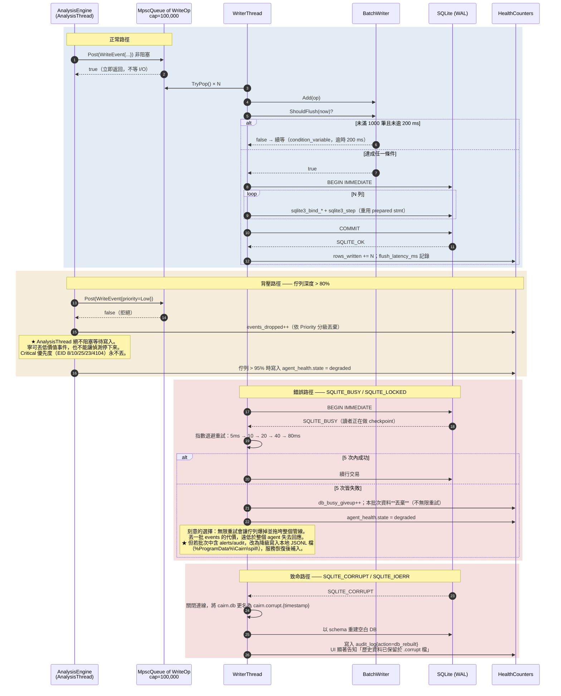

**佇列容量 100,000 的取值**：以最壞事件率 5,000/s、flush 週期 200 ms 計，
穩態佇列深度約 1,000。100,000 給了 20 秒的緩衝，足以吸收
「Retention 的長 DELETE + 磁碟突發忙碌」這類數秒級的停頓。
每個 `WriteOp` 約 400 bytes → 最壞記憶體佔用 40 MB，在 NFR 預算內。

---

## 6.5 查詢路徑與讀寫併發

**WAL 模式的核心優勢**：讀者不阻塞寫者、寫者不阻塞讀者。
UI 在查詢 7 天的程序樹時，`WriterThread` 可以持續寫入。

| 規則 | 說明 |
|---|---|
| **每個執行緒一個連線** | 本專案以 `SQLITE_THREADSAFE=2`（multi-thread，對齊 part2 §2.3.2 的檔頭）建置，SQLite 不對連線加內部鎖，「每執行緒一個連線」由架構而非函式庫保證。我們**明文禁止**共用：`RpcServer` 的每個 worker 執行緒在首次查詢時以 `thread_local` 開啟自己的 Reader 連線 |
| **Reader 連線一律唯讀** | `sqlite3_open_v2(..., SQLITE_OPEN_READONLY, ...)`。編譯期就杜絕「UI 路徑不小心寫入」 |
| **Reader 的 PRAGMA** | `busy_timeout=3000`、`cache_size=-8192`（8 MB，比 writer 小）、`query_only=1` |
| **長查詢保護** | 每個 RPC 查詢以 `sqlite3_progress_handler` 設 2 秒上限，逾時中止並回 `504`；避免 UI 的一個爛查詢把 WAL 撐大 |
| **WAL 大小控制** | Reader 持有的長交易會阻止 checkpoint，使 `-wal` 檔無限成長。故 Reader **禁止顯式交易**，每個查詢一個隱式交易，且 `RpcServer` 不做「開著 cursor 慢慢讀」的分頁——一律 `LIMIT/OFFSET` 一次讀完 |

**核心查詢**（part3 §3.8.2 的告警詳情，全產品最重要的單一查詢）：

```sql
-- 一次撈出整棵程序樹（遞迴 CTE），SQLite 3.8.3+ 原生支援
WITH RECURSIVE subtree(process_guid, depth) AS (
    SELECT process_guid, 0 FROM process_tree WHERE process_guid = :root
    UNION ALL
    SELECT p.process_guid, s.depth + 1
      FROM process_tree p JOIN subtree s ON p.parent_process_guid = s.process_guid
     WHERE s.depth < 64
)
SELECT p.* FROM process_tree p JOIN subtree s USING(process_guid) ORDER BY p.start_ts;
```
`ix_ptree_parent` 索引使每層查找為索引掃描；典型樹 < 50 節點，實測 < 3 ms。

---

## 6.6 Retention 與資料庫大小控制

```cpp
// RetentionJob 的排程：WriterThread 每次 flush 後檢查，每小時實際執行一次
RetentionStats RetentionJob::RunIfDue(SqliteStore& db, int64_t nowMs)
{
    if (nowMs - m_lastRunMs < kRetentionIntervalMs) return {};
    m_lastRunMs = nowMs;

    RetentionStats st;
    // ★ 分批刪除：每批獨立交易，讓出寫鎖給正常寫入
    // ⚠ 三個實作陷阱，見下方說明：
    //   ① DELETE ... LIMIT 需 SQLITE_ENABLE_UPDATE_DELETE_LIMIT，vcpkg 的 sqlite3 預設未開；
    //      DeleteBatched 一律以 `WHERE rowid IN (SELECT rowid ... ORDER BY ... LIMIT n)` 實作。
    //   ② events 不可刪掉被 alert_events / rule_hits 引用者，否則 90 天內的告警
    //      時間軸與命中明細會被 CASCADE 連帶刪光。
    //   ③ process_tree 的時間欄是 start_ts（不是 ts），且必須加 end_ts IS NOT NULL，
    //      否則會刪掉仍在執行的程序並 CASCADE 掉其 scores。
    st.events  = DeleteEventsExcludingReferenced(nowMs - m_eventTtlMs, 50000);
    st.ptree   = DeleteBatched("process_tree", "start_ts", nowMs - m_eventTtlMs, 50000,
                               /*extraWhere=*/"end_ts IS NOT NULL");
    // rule_hits / alert_events 的保留期跟 alerts（90 天），不跟 events（7 天）
    st.hits    = DeleteBatched("rule_hits",    "ts", nowMs - m_alertTtlMs, 50000);
    st.alerts  = DeleteBatched("alerts",       "ts", nowMs - m_alertTtlMs, 5000);
    // audit_log 永不自動刪除（完整性鏈不可斷）—— 只在硬上限時封存為檔案
    st.pagesFreed = IncrementalVacuum(1000);
    st.hardCap    = EnforceHardCap(db);
    return st;
}
```

**分批的必要性**：一次 `DELETE FROM events WHERE ts < cutoff` 在 3,000 萬列上
會持有寫鎖數十秒，期間所有寫入卡死、佇列爆掉。
`LIMIT 50000` 每批約 200–400 ms，批間讓出寫鎖，正常寫入得以插隊。

**`incremental_vacuum` 的前提**：`PRAGMA auto_vacuum = INCREMENTAL`
**必須在資料庫第一次建表之前設定**。事後才設需要整庫 `VACUUM`（4 GB 檔約需數分鐘且要 2 倍磁碟空間）。
故 `SqliteStore::Open` 中該 PRAGMA 必須在任何 `CREATE TABLE` 之前執行，
且需以 `PRAGMA auto_vacuum;` 回讀驗證——**這個錯誤在開發期不會有任何症狀，
只在客戶跑滿三個月磁碟撐爆時才爆發**，故列為必測項（§6.8）。

**對寫入延遲的影響量測**：
```
量測方法：以 tools/EventReplay.exe 灌入穩定 2,000 events/s，
          持續 30 分鐘（跨越一次 retention 執行），
          記錄 BatchWriter::Flush 的每次耗時，畫成時序圖。
通過門檻：retention 執行期間的 flush P99 <= 平時 P99 的 3 倍，
          且無任何一次 flush > 2 秒，
          且 events_dropped 增量為 0。
不達標時的退路：把 DeleteBatched 的 LIMIT 由 50000 降至 10000，
          或把 retention 週期由 1 小時改為 15 分鐘（每次刪更少）。
```

**硬上限保護**（`max_db_size_mb`，預設 4096）：
超過時強制刪除最舊 10% 的 `events`，寫入 `audit_log`，並在 UI 顯示
「資料庫已達上限，最舊的 N 天事件已被移除」——**不得靜默丟棄**。

---

## 6.7 崩潰復原

### 6.7.1 WAL checkpoint 策略

| 設定 | 值 | 理由 |
|---|---|---|
| `wal_autocheckpoint` | 4000 pages（約 16 MB） | 預設 1000 太積極，會讓寫入路徑頻繁被 checkpoint 打斷 |
| 主動 checkpoint | 每次 alert/audit 提交後 `PASSIVE`；服務停止時 `TRUNCATE` | 告警要盡快落到主 DB；停止時把 WAL 清空，讓下次啟動不需重播 |
| `journal_size_limit` | 64 MB | checkpoint **之後**把 `-wal` 截回 64 MB，避免尖峰後檔案長期停在高水位。⚠ 它不能防止讀者長交易期間的 WAL 成長（那段期間 checkpoint 本來就推不動），那由 §6.5 的「Reader 禁止顯式交易 + 2 秒查詢上限」控制 |

### 6.7.2 非正常結束的偵測與處理

```
啟動流程：
1. 檢查 %ProgramData%\Cairn\clean_shutdown.marker
   · 存在 → 上次是正常關閉 → 刪除 marker，直接開啟 DB
   · 不存在 → 上次是崩潰/斷電
2. 崩潰路徑：
   a. 開啟 DB（SQLite 會自動重播 WAL —— 這是免費的，不需我們做事）
   b. PRAGMA quick_check;        ← 不是 integrity_check
   c. 檢查 spill 目錄是否有未補入的 alerts/audit JSONL → 補入
   d. 寫入 audit_log{action=unclean_start, wal_replayed_pages=N}
   e. ★ 所有記憶體狀態（ProcessTree / ScoreBoard / SequenceState）一律不還原
3. 正常停止：flush → wal_checkpoint(TRUNCATE) → 寫 marker → 關閉
```

**為什麼是 `quick_check` 而不是 `integrity_check`**：
`integrity_check` 在 4 GB 資料庫上需要數分鐘且會讀完整個檔案，
放在服務啟動路徑上代表「每次斷電後端點有數分鐘沒有防護」——不可接受。
`quick_check` 跳過索引與內容的交叉驗證，在同樣的檔案上約 2–5 秒。
完整的 `integrity_check` 改為**每週一次於閒置時（CPU < 10% 持續 5 分鐘）於 Reader 連線執行**。

**為什麼記憶體狀態一律不還原（步驟 2e）**：
理論上可以從 `process_tree` 與 `scores` 表重建程序樹與分數。
**M0 刻意不做**，理由：
1. 重建後的樹與真實系統狀態不同步——服務停止期間的程序建立/結束完全沒被觀測到，
   重建出來的是一棵**已知不正確**的樹，會產生無法解釋的誤報。
2. `SequenceState` 根本無法重建（部分比對的中間狀態未持久化，也不應持久化）。
3. 服務重啟後的正確行為是**重新開始觀測**，並在 UI 明確標示
   「服務於 HH:MM 重啟，此前的行為關聯已重置」。誠實勝過假裝連續。

M1 若要支援熱重啟不失憶，正確做法是把 `AnalysisThread` 的輸入事件流持久化為 WAL 並在啟動時重播，
而不是還原派生狀態。列為技術債。

### 6.7.3 分級持久性保證總表

| 資料 | 保證等級 | 最壞損失 | 機制 |
|---|---|---|---|
| `events` | Best-effort | 最後 200 ms + 佇列中未 flush 者 | `synchronous=NORMAL`，背壓時可主動丟棄 |
| `process_tree` / `scores` | Best-effort | 同上；且重啟後不還原至記憶體 | 同上 |
| `alerts` | **Durable** | 0 | `synchronous=FULL` + 立即 checkpoint；DB 不可用時降級寫 spill JSONL |
| `audit_log` | **Durable + 完整性鏈** | 0 | 同上，且 `prev_hash` 鏈可偵測任何單列竄改 |
| `agent_health` | Best-effort | 最後 60 s | 每分鐘一列，丟了不影響任何判斷 |

---

## 6.8 本冊的必測項（移交 SDD-04 測試計畫）

| # | 測試 | 為何必測 |
|---|---|---|
| T-01 | `DecayMilli` 的定點數正確性與單調性（含 dt 極大、halfLife 極小的邊界） | 分數是全系統的核心；錯了整個偵測就錯了 |
| T-02 | 分數重放決定性：同一事件序列跑 100 次，分數與告警逐位元相同 | §4.3.1 的核心承諾 |
| T-03 | 孤兒節點延遲掛載：亂序事件序列 → 樹結構與正序一致；`MergeRoot` 後分數不丟失 | 亂序是常態不是異常 |
| T-04 | PID 重用：同一 PID 對應兩個 ProcessGuid 時分數不串接 | 最危險的誤報來源 |
| T-05 | `SequenceMatcher` 的 `within` 過期：邊界值 ±1 ms | 時間窗錯誤會造成靜默漏報 |
| T-06 | 狀態爆炸防護：灌入 10,000 個步驟 0 → 記憶體有界、`seq_state_evicted` 正確計數 | 對抗場景的必要防線 |
| T-07 | 熱重載：規則改變時 in-flight 狀態被正確丟棄；語法錯誤時舊規則集存活 | 「絕不因規則錯誤停擺」是硬性要求 |
| T-08 | 排除清單：`suppressed` 命中時 `hit_count++` 且分數不變 | 可稽核性的基礎 |
| T-09 | `auto_vacuum=INCREMENTAL` 在建表前生效（回讀驗證） | 錯了三個月後才會爆發 |
| T-10 | 背壓：佇列灌滿時 Critical 事件不丟、Low 事件被丟、AnalysisThread 不阻塞 | 攻擊當下正是佇列最滿的時刻 |
| T-11 | 崩潰復原：kill -9 服務 → 重啟後 `alerts`／`audit_log` 無遺失；`events` 損失 ≤（`kBatchMaxAgeMs` + 佇列殘留），實測記錄殘留筆數作為 NFR 基線 | 分級持久性的驗證。⚠ 舊版寫「< 200 ms」與 §6.7.3 自承的「最後 200 ms **＋佇列中未 flush 者**（上限 10 萬筆 ≈ 20 秒）」矛盾 |
| T-12 | Retention 執行期間的寫入延遲（§6.6 的量測方法與門檻） | 長交易鎖死是最常見的自傷 |

---

## §7 待回填 PRD 的項目（本冊產生的變更）

| # | 目標文件 | 內容 |
|---|---|---|
| P-1 | part2 §2.3.2 | 套用 §6.1.1 的 S-1 ~ S-13 schema 變更 |
| P-2 | part2 §2.4.3 | **勘誤**：「採用最短半衰期（保守：讓分數退得慢一點）」措辭與數學矛盾。改為「採用**最長**半衰期」 |
| P-3 | part2 §2.4.3 | 分數改以 milli-point 整數表示；API 層負責轉為十進位小數 |
| P-4 | part2 §2.4.2 | DSL 補上 `threshold.distinct_field` 的上限（4096）與超限行為 |
| P-5 | part3 §3.2.3 | 告警詳情需顯示「構成鏈的事件與其步驟序號」，資料來自新增的 `alert_events` 表 |
| P-6 | part3 §3.8 | 新增 `GET /alerts/{id}/hits`（規則命中明細，含 suppressed 者）—— 誤報排查的關鍵資料 |
| P-7 | part4 §4.5 | 併入 §6.8 的 T-01 ~ T-12 必測項 |

---

*文件結束 — SDD-02*
